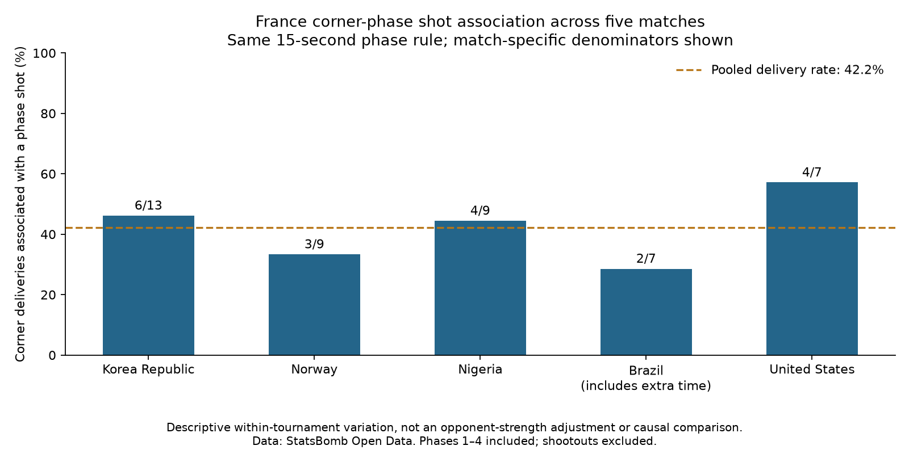

# France’s corner phases across five World Cup matches

**Alireza Erfanian · Football Analytics Research Lab · Guided research · 4 November 2026**

**Question:** How often were France’s corners associated with a shot, and what should a coach review next?

- **5 fixtures, 45 recorded corner deliveries.**
- **19/45 (42.2%)** associated with at least one shot under the defined phase rule.
- **21 associated shots, 2 goals.** Both goals came against Korea Republic.

## Findings

The match-by-match denominators are small. The Korea Republic goal outcome alone gives an incomplete view of the campaign; shot-associated phases occur in all five fixtures.

Delivery-type comparisons mix takers and corner sides. No same-taker/side/match group contains both recorded inswingers and outswingers, limiting a direct like-for-like comparison. Nine technique labels are unrecorded and remain visible.

## Practical next action

Use the [six-event review brief](26_corner_video_review_brief.md) to inspect first contact, receiving control and defensive marking. Footage has not yet been reviewed. These data support review priorities rather than a recommendation to switch delivery technique or target zone.

## Method and limits

Count every recorded corner Pass event, including incomplete deliveries. Associate same-team non-penalty shots within 15 seconds in the same possession, stopping at a new restart, period/possession change or goal. Include extra time and assign each shot once. This is a descriptive phase proxy, not causal corner value.

Pool counts before division to weight each delivery equally. The Korea Republic window check yields 4/13 at five seconds and 6/13 at 10, 15 and 20 seconds; it has not been repeated across every match. Recorded endpoints do not establish intended targets or controlled receptions.

[Full study](21_france_tournament_corner_study.md) · [Comparison support](24_corner_side_context.md) · [Reproduce the analysis](../38_france_tournament_corners.py) · [Styled local/print view](36_france_corner_portfolio_case_study.html)

Data: [StatsBomb Open Data](https://github.com/statsbomb/open-data). Course foundation: [Soccermatics](https://soccermatics.readthedocs.io/en/latest/). Guided research and implementation prepared with AI assistance. Independent reproduction and interpretation remain separate milestones. No club impact, completed video scouting or independent mastery is claimed.
