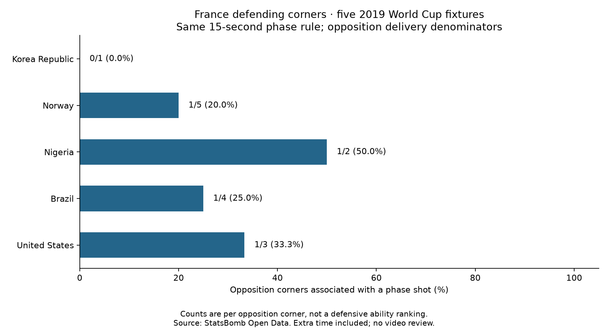

# France defending opposition corners

France faced **15 opposition corner deliveries** in the existing five-match sample. **4/15 (26.7%)** were associated with at least one opposition shot under the fixed phase rule. Those phases contained **4 shots and 0 shot goals**.

- Korea Republic Women's: 0/1 (0.0%) corners associated with a shot; 0 phase shots, 0 shot goals.
- Norway Women's: 1/5 (20.0%) corners associated with a shot; 1 phase shots, 0 shot goals.
- Nigeria Women's: 1/2 (50.0%) corners associated with a shot; 1 phase shots, 0 shot goals.
- Brazil Women's: 1/4 (25.0%) corners associated with a shot; 1 phase shots, 0 shot goals.
- United States Women's: 1/3 (33.3%) corners associated with a shot; 1 phase shots, 0 shot goals.

## What changed

The old question counted France's attacking corners: 19/45 (42.2%) led to a France shot. This report switches the attacking team to France's opponent in each fixture. The denominator is now opposition corners faced, and the numerator is opposition corners associated with an opposition shot. These are separate sets of deliveries, not complementary percentages.

The five fixtures and phase rules are unchanged: periods 1–4 including extra time; non-penalty shots; same possession; at most 15 seconds; stop at restart, period/possession change, shot goal or own goal. The goal shot is included before stopping. A shot is assigned only once. This is a counting study with no xG prediction or shot-quality adjustment.

## Interpretation for an analyst

The measured rate describes shot association per corner faced. It does not establish why a shot occurred, whether a marker made an error, or France's defensive ability relative to other teams. Opponents, delivery choices and match contexts differ, and we do not adjust for them. A corner without a linked phase shot is not automatically an excellent defensive action: the bounded rule can miss later attacks or stop after a possession change.

These records nominate events for video review; no footage was reviewed in this lesson. The next practical review question is: on the shot-associated opposition corners, who made first contact, was the first clearance controlled, and how did the shot arise? Event records alone do not establish those answers.

## Reproduce

Run `python 60_france_defensive_corners.py` in Spyder or locally. Previously downloaded files are reused and checked against the existing raw hashes. If absent, only the five recorded match files are downloaded and hash checked. [Saved evidence](../data/60_france_defensive_corner_evidence.json) preserves every selected corner and shot ID. [Short lesson](../lessons/0042-france-defensive-corners.html).

This is an assisted worked extension on already inspected data. Source: [StatsBomb Open Data](https://github.com/statsbomb/open-data), using the original source snapshots and attribution. The view changes; the source population and definition do not.
