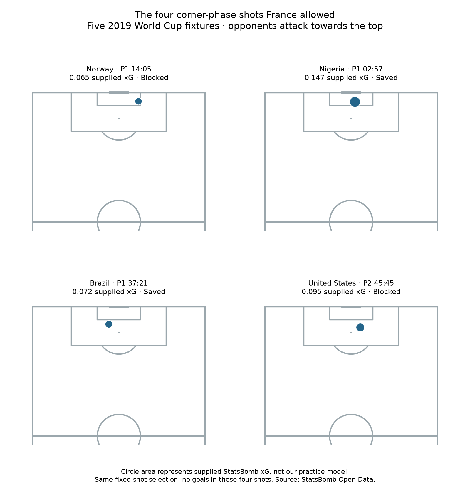

# Quality of the corner-phase shots France allowed

The unchanged five-match defensive selection contains **4 shots from 15 opposition corners**, with **0 shot goals**. Their supplied StatsBomb xG sums to **0.379418**.

- Norway Women's, period 1 at 14:05: 0.065178 xG; Head; Blocked.
- Nigeria Women's, period 1 at 02:57: 0.147017 xG; Head; Saved.
- Brazil Women's, period 1 at 37:21: 0.072496 xG; Head; Saved.
- United States Women's, period 2 at 45:45: 0.094728 xG; Left Foot; Blocked.

Calculation: 0.065177720 + 0.147017100 + 0.072495505 + 0.094727926 = 0.379418251 xG. Values displayed here are rounded; saved evidence preserves the supplied numerical values.

## Frequency, quality and outcome

- Corners associated with a shot: 4/15 = 26.7%.
- Average supplied xG per shot: 0.379418/4 = 0.094855.
- Supplied xG per corner faced: 0.379418/15 = 0.025295.
- Actual shot goals in these phases: 0.

The frequency counts how often a corner was associated with a shot. Mean xG describes the provider-estimated scoring chance of the selected shots. Goals record what actually happened. None is a substitute for the other two.

The identity is xG per corner = shots per corner × mean xG per shot. Use the number of shots here, not the number of positive corners: they happen to both be four in this sample, but one corner can produce several shots. The xG-per-corner number is an average expected-goal total per observed delivery, not generally the probability that a corner produces at least one goal.

## What the xG numbers mean

These are the existing provider's shot.statsbomb_xg values. We did not fit, improve or evaluate our earlier educational model here. A value around 0.147 is the provider's estimated 14.7% scoring probability for that shot, not a known true chance or a guaranteed outcome. The exact provider model version is not supplied in these snapshots.

Summed xG is an expected-goal total under those shot estimates, not the probability of at least one goal. Zero actual goals alongside about 0.38 xG does not prove exceptional defending or goalkeeper performance. Two of these shots were blocked and two saved. This sample is small, unadjusted and uses only the bounded phase definition; later chances and penalties are outside it. No new footage was reviewed.

## Reproduce

Run `python 61_defensive_corner_shot_quality.py` locally or in Spyder. All selected shot IDs are preserved and checked against the original hash-verified event files. Missing or invalid xG stops enrichment rather than becoming zero. No-shot matches have zero selected xG and an undefined mean xG per shot.

[Saved evidence](../data/61_defensive_corner_quality_evidence.json) · [Short lesson](../lessons/0043-defensive-corner-shot-quality.html). Assisted worked extension, not independent proficiency.

Source: [StatsBomb Open Data](https://github.com/statsbomb/open-data). Definition reference: [Hudl StatsBomb expected goals glossary](https://support.hudl.com/s/article/expected-goals?language=en_US&topic=Statsbomb_Global_Football_Data_Glossary).
