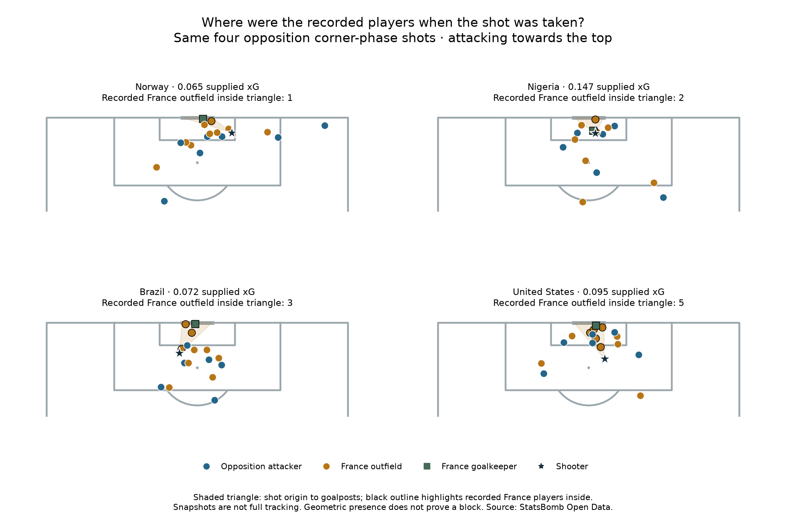

# Defensive context at the moment of the shot

We joined the same four selected shot IDs to their recorded StatsBomb shot.freeze_frame arrays. We have not added tracking data or watched footage.

- Norway Women's: 17 recorded frame players; 1/9 recorded defending outfield players inside the triangle; 1/1 recorded defending goalkeepers inside. Supplied xG 0.065; Blocked.
- Nigeria Women's: 16 recorded frame players; 2/9 recorded defending outfield players inside the triangle; 1/1 recorded defending goalkeepers inside. Supplied xG 0.147; Saved.
- Brazil Women's: 16 recorded frame players; 3/9 recorded defending outfield players inside the triangle; 1/1 recorded defending goalkeepers inside. Supplied xG 0.072; Saved.
- United States Women's: 17 recorded frame players; 5/10 recorded defending outfield players inside the triangle; 1/1 recorded defending goalkeepers inside. Supplied xG 0.095; Blocked.

## Definition

The drawn triangle connects the shot origin to goalposts (120,36) and (120,44) in the StatsBomb coordinate system, matching the installed mplsoccer StatsBomb pitch dimensions. We count recorded player centres on or inside that closed triangle, with numerical tolerance 1e-9. This is a transparent project calculation inspired by the goal-cone concept, not a claim to reproduce the provider's exact feature implementation.

teammate=True means a teammate of the shooter: an opposition attacker in this defensive study. teammate=False means a French player. Recorded position ID 1 identifies goalkeepers, counted separately from outfield defenders. The shooter is drawn at the shot origin as a star; the frame need not include the shooter as a separate player record. Every supplied frame player is shown.

## What this adds—and what it cannot establish

We can see recorded French player positions around each attempt, and whether their centres lie geometrically between the shot and the goalmouth. These counts do not prove a player was able to block the ball. Body size, movement, ball height, timing and the actual shot trajectory are not modelled. Three attempts were headers, making a flat ground-position diagram particularly incomplete.

Frames contain relevant recorded players, not a guaranteed complete set of everyone on the pitch. Different recorded counts must not be interpreted as players missing from the team or proof of a defensive overload. Missing/empty frames produce undefined counts, not zeros. A recorded frame with no qualifying defender is a different case.

We have four selected shots, no comparison model and no controlled experiment. We cannot attribute their xG differences to this count, infer assigned marking responsibilities, or grade defenders from it. The feature describes shot-time context, not pre-corner shape or live movement. No new model was trained.

## Reproduce

Run `python 62_defensive_shot_freeze_frames.py` in Spyder or locally. The existing raw snapshot hashes are checked. [Saved evidence](../data/62_defensive_freeze_frame_evidence.json) preserves each recorded player position and triangle membership. [Short lesson](../lessons/0044-defensive-shot-freeze-frames.html). This worked assignment was assisted.

Primary sources: [StatsBomb freeze-frame explanation](https://blogarchive.statsbomb.com/news/statsbomb-data-case-studies-freeze-frames-and-defender-locations/) and [Open Data specification, Appendix 3](https://raw.githubusercontent.com/statsbomb/open-data/master/doc/StatsBomb%20Open%20Data%20Specification%20v1.1.pdf). Football source: StatsBomb Open Data. Geometry labels describe this project's explicit calculation.
