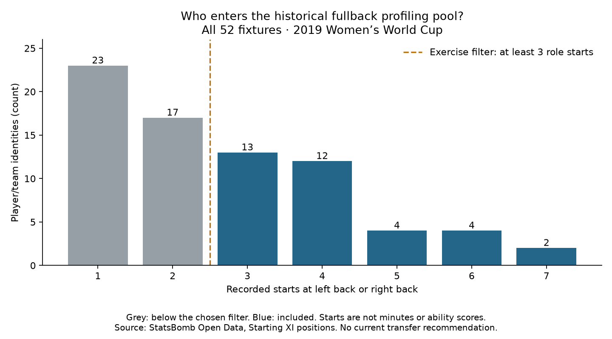

# Recruitment phase: a historical fullback profiling pool

Question: which players in this tournament meet a clearly defined starting-role filter for the next fullback profiling exercise?

Across **52 matches**, we checked **104 starting lineups** and **1144 starting-player records**. **75 player/team identities** started at left back or right back at least once. **35** met our minimum of **3 starts** in those positions; **40** did not.

## Eligibility rules

Use the recorded period-1 Starting XI lineup, not event locations or player reputation. Left Back and Right Back qualify; wingback and other starting positions do not. Group by player ID and team ID; preserve name variants instead of treating names as unique identifiers. Count no more than one start per player/match/team.

The minimum of three is a fixed educational sample filter, not proof of enough observations for reliable performance estimates. A player can qualify through mixed left/right starts; we retain the split and will keep role/side context visible in later profiling. Starting position does not establish the role for every subsequent minute. Substitute appearances, later tactical shifts and wingback starts are outside this filter and must not be interpreted as missing appearances.

Team tournament length, rotation, injuries and formation choices affect eligibility. Excluded players are not judged worse. This pool is not ranked by ability and is not a signability or transfer shortlist. The 2019 tournament is a historical learning dataset, not evidence of current form, age, contract status, price or availability.

## Eligible profiling pool, alphabetical by team and name

- Argentina Women's — Eliana Noemí Stábile (player ID 25633): 3 qualifying starts; left back 3, right back 0.
- Australia Women's — Ellie Madison Carpenter (player ID 5095): 4 qualifying starts; left back 0, right back 4.
- Brazil Women's — Letícia Santos de Oliveira (player ID 25560): 4 qualifying starts; left back 0, right back 4.
- Brazil Women's — Tamires Cássia Dias de Britto (player ID 25559): 4 qualifying starts; left back 4, right back 0.
- Cameroon W — Yvonne Patrice Leuko (player ID 25623): 3 qualifying starts; left back 3, right back 0.
- Canada Women's — Allysha Lyn Chapman (player ID 5038): 3 qualifying starts; left back 3, right back 0.
- Canada Women's — Ashley Elizabeth Marie Lawrence (player ID 15290): 3 qualifying starts; left back 0, right back 3.
- China PR Women's — Peng Han (player ID 25481): 4 qualifying starts; left back 0, right back 4.
- China PR Women's — Shanshan Liu (player ID 25486): 4 qualifying starts; left back 4, right back 0.
- England Women's — Alex Greenwood (player ID 10252): 4 qualifying starts; left back 4, right back 0.
- England Women's — Demi Stokes (player ID 4651): 3 qualifying starts; left back 3, right back 0.
- England Women's — Lucy Bronze (player ID 10178): 7 qualifying starts; left back 0, right back 7.
- France Women's — Amel Majri (player ID 15249): 5 qualifying starts; left back 5, right back 0.
- France Women's — Marion Torrent (player ID 25446): 4 qualifying starts; left back 0, right back 4.
- Germany Women's — Giulia Gwinn (player ID 25492): 3 qualifying starts; left back 0, right back 3.
- Germany Women's — Verena Schweers (player ID 15423): 3 qualifying starts; left back 3, right back 0.
- Italy Women's — Alia Guagni (player ID 10213): 5 qualifying starts; left back 2, right back 3.
- Italy Women's — Elisa Bartoli (player ID 10371): 4 qualifying starts; left back 3, right back 1.
- Jamaica Women's — Deneisha Selena Blackwood (player ID 25557): 3 qualifying starts; left back 3, right back 0.
- Japan Women's — Aya Sameshima (player ID 25636): 4 qualifying starts; left back 4, right back 0.
- Japan Women's — Risa Shimizu (player ID 25624): 4 qualifying starts; left back 0, right back 4.
- Korea Republic Women's — Sel-Gi Jang (player ID 25447): 3 qualifying starts; left back 2, right back 1.
- Netherlands Women's — Desiree van Lunteren (player ID 10657): 7 qualifying starts; left back 0, right back 7.
- Netherlands Women's — Merel van Dongen (player ID 25659): 4 qualifying starts; left back 4, right back 0.
- Nigeria Women's — Chidinma Nkeruka Okeke (player ID 25462): 3 qualifying starts; left back 0, right back 3.
- Nigeria Women's — Ngozi Ebere (player ID 25468): 3 qualifying starts; left back 3, right back 0.
- Norway Women's — Ingrid Moe Wold (player ID 10382): 5 qualifying starts; left back 0, right back 5.
- Norway Women's — Kristine Minde (player ID 10393): 5 qualifying starts; left back 5, right back 0.
- South Africa Women's — Lebogang Ramalepe (player ID 25520): 3 qualifying starts; left back 0, right back 3.
- Spain Women's — Marta Corredera Rueda (player ID 10200): 4 qualifying starts; left back 2, right back 2.
- Sweden Women's — Hanna Erica Maria Glas (player ID 24693): 6 qualifying starts; left back 0, right back 6.
- Sweden Women's — Magdalena Lilly Eriksson (player ID 4633): 6 qualifying starts; left back 6, right back 0.
- Thailand W — Sunisa Srangthaisong (player ID 25675): 3 qualifying starts; left back 3, right back 0.
- United States Women's — Crystal Alyssia Dunn Soubrier (player ID 5088): 6 qualifying starts; left back 6, right back 0.
- United States Women's — Kelley Maureen O'Hara (player ID 5021): 6 qualifying starts; left back 0, right back 6.

## Next measurements

Audit playing-time denominators, then build role-aware passing volume, progression and completion profiles. Three starts cannot be substituted for 270 actual minutes. No performance rates, percentiles, ability recommendations or video assessments are produced in this eligibility step.

## Reproduce

Run `python 63_fullback_recruitment_cohort.py` in Spyder or locally. Existing raw event snapshots and tournament metadata are hash checked; missing files are downloaded from their recorded URLs and checked before use. All existing 52 fixtures are retained. [Protocol](../data/63_fullback_cohort_protocol.json) · [Evidence](../data/63_fullback_cohort_evidence.json) · [Short lesson](../lessons/0045-recruitment-fullback-cohort.html).

Assisted worked exercise on already inspected data. Source: StatsBomb Open Data. This custom exercise applies ideas from [Soccermatics statistical scouting](https://soccermatics.readthedocs.io/en/latest/lesson3/ScoutingPlayers.html); it is not a claim to reproduce the course's exact assignment or a preregistered experiment. [StatsBomb specification](https://raw.githubusercontent.com/statsbomb/open-data/master/doc/StatsBomb%20Open%20Data%20Specification%20v1.1.pdf) documents Starting XI and lineup positions.
