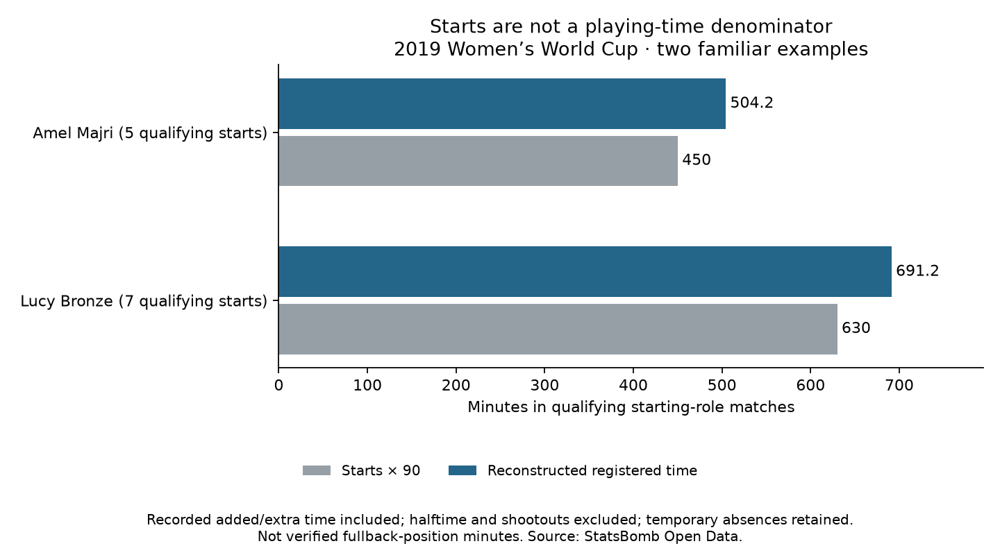

# Playing-time denominators for the fullback study

Competition and season: **FIFA Women’s World Cup, 2019**. StatsBomb competition 72, season 30.

Course reading: [Soccermatics Lesson 3 — Statistical scouting, Normalisation](https://soccermatics.readthedocs.io/en/latest/lesson3/ScoutingPlayers.html#normalisation). This custom exercise prepares minute denominators for later per-90 profiling.

We reconstructed registered playing intervals across all 52 tournament matches and checked the time balance for 104 teams in those matches. The unchanged 35-player pool contributes 145 qualifying fullback starts. We sum each player's intervals in those qualifying fixtures only.

- Argentina Women's — Eliana Noemí Stábile: 3 qualifying starts; 288.59 reconstructed minutes (starts × 90 would give 270).
- Australia Women's — Ellie Madison Carpenter: 4 qualifying starts; 426.04 reconstructed minutes (starts × 90 would give 360).
- Brazil Women's — Letícia Santos de Oliveira: 4 qualifying starts; 365.88 reconstructed minutes (starts × 90 would give 360).
- Brazil Women's — Tamires Cássia Dias de Britto: 4 qualifying starts; 427.20 reconstructed minutes (starts × 90 would give 360).
- Cameroon W — Yvonne Patrice Leuko: 3 qualifying starts; 302.19 reconstructed minutes (starts × 90 would give 270).
- Canada Women's — Allysha Lyn Chapman: 3 qualifying starts; 250.75 reconstructed minutes (starts × 90 would give 270).
- Canada Women's — Ashley Elizabeth Marie Lawrence: 3 qualifying starts; 291.59 reconstructed minutes (starts × 90 would give 270).
- China PR Women's — Peng Han: 4 qualifying starts; 387.51 reconstructed minutes (starts × 90 would give 360).
- China PR Women's — Shanshan Liu: 4 qualifying starts; 387.51 reconstructed minutes (starts × 90 would give 360).
- England Women's — Alex Greenwood: 4 qualifying starts; 401.34 reconstructed minutes (starts × 90 would give 360).
- England Women's — Demi Stokes: 3 qualifying starts; 289.85 reconstructed minutes (starts × 90 would give 270).
- England Women's — Lucy Bronze: 7 qualifying starts; 691.18 reconstructed minutes (starts × 90 would give 630).
- France Women's — Amel Majri: 5 qualifying starts; 504.23 reconstructed minutes (starts × 90 would give 450).
- France Women's — Marion Torrent: 4 qualifying starts; 412.49 reconstructed minutes (starts × 90 would give 360).
- Germany Women's — Giulia Gwinn: 3 qualifying starts; 294.29 reconstructed minutes (starts × 90 would give 270).
- Germany Women's — Verena Schweers: 3 qualifying starts; 191.30 reconstructed minutes (starts × 90 would give 270).
- Italy Women's — Alia Guagni: 5 qualifying starts; 454.40 reconstructed minutes (starts × 90 would give 450).
- Italy Women's — Elisa Bartoli: 4 qualifying starts; 317.56 reconstructed minutes (starts × 90 would give 360).
- Jamaica Women's — Deneisha Selena Blackwood: 3 qualifying starts; 286.22 reconstructed minutes (starts × 90 would give 270).
- Japan Women's — Aya Sameshima: 4 qualifying starts; 382.96 reconstructed minutes (starts × 90 would give 360).
- Japan Women's — Risa Shimizu: 4 qualifying starts; 382.96 reconstructed minutes (starts × 90 would give 360).
- Korea Republic Women's — Sel-Gi Jang: 3 qualifying starts; 287.33 reconstructed minutes (starts × 90 would give 270).
- Netherlands Women's — Desiree van Lunteren: 7 qualifying starts; 723.98 reconstructed minutes (starts × 90 would give 630).
- Netherlands Women's — Merel van Dongen: 4 qualifying starts; 422.51 reconstructed minutes (starts × 90 would give 360).
- Nigeria Women's — Chidinma Nkeruka Okeke: 3 qualifying starts; 298.17 reconstructed minutes (starts × 90 would give 270).
- Nigeria Women's — Ngozi Ebere: 3 qualifying starts; 269.22 reconstructed minutes (starts × 90 would give 270).
- Norway Women's — Ingrid Moe Wold: 5 qualifying starts; 478.07 reconstructed minutes (starts × 90 would give 450).
- Norway Women's — Kristine Minde: 5 qualifying starts; 524.48 reconstructed minutes (starts × 90 would give 450).
- South Africa Women's — Lebogang Ramalepe: 3 qualifying starts; 289.98 reconstructed minutes (starts × 90 would give 270).
- Spain Women's — Marta Corredera Rueda: 4 qualifying starts; 390.66 reconstructed minutes (starts × 90 would give 360).
- Sweden Women's — Hanna Erica Maria Glas: 6 qualifying starts; 632.60 reconstructed minutes (starts × 90 would give 540).
- Sweden Women's — Magdalena Lilly Eriksson: 6 qualifying starts; 615.27 reconstructed minutes (starts × 90 would give 540).
- Thailand W — Sunisa Srangthaisong: 3 qualifying starts; 289.22 reconstructed minutes (starts × 90 would give 270).
- United States Women's — Crystal Alyssia Dunn Soubrier: 6 qualifying starts; 590.60 reconstructed minutes (starts × 90 would give 540).
- United States Women's — Kelley Maureen O'Hara: 6 qualifying starts; 530.50 reconstructed minutes (starts × 90 would give 540).

## Time convention and audit

The maximum recorded Half End timestamp defines each period length; missing or explicitly early-video-end signals stop reconstruction. Period offsets add playing periods together, excluding halftime gaps. Recorded added time and extra time count; shootouts do not. Substitutions close the outgoing registration and open the replacement at the same instant. Active dismissals and permanent departures close an interval without replacement. Temporary Player Off/On absences are retained under the registered-time convention; they are not physical-on-pitch or ball-in-play minutes.

For every team we verify: summed player interval time = 11 × recorded match duration − time lost after active permanent departures. An inactive-player dismissal cannot reduce that team’s active player time again. Full interval and event-ID audit trails are saved. This arithmetic audit is not an independent comparison with official playing-time totals.

## Use these denominators correctly

Three starts need not equal 270 minutes. Early substitutions can lower the time, while added time or extra time can raise it. A toy example: 10 selected actions in 200 minutes gives 10/200 × 90 = 4.5 per 90; the action count is illustrative, not an observed player result.

These intervals cover only the matches where the selected player started in an eligible role. Other appearances are excluded from the selected denominator. They include later tactical role changes, so they are not verified position-specific minutes. Future action counts must use exactly the same selected fixtures and active-player intervals. Possession and opponent context still need attention after time normalization. No action-rate calculation or ranking is produced in this lesson.

## Reproduce and read

Run `python 64_fullback_playing_time.py` in Spyder or locally. [Evidence](../data/64_fullback_playing_time_evidence.json) · [Lesson](../lessons/0046-fullback-playing-time.html) · [Recruitment reference](../reference/recruitment-analysis.html).

Source: [StatsBomb Open Data](https://github.com/statsbomb/open-data), **2019 Women’s World Cup**; fields documented in the [Open Data specification](https://raw.githubusercontent.com/statsbomb/open-data/master/doc/StatsBomb%20Open%20Data%20Specification%20v1.1.pdf). Assisted historical exercise; independent skill remains to demonstrate.
