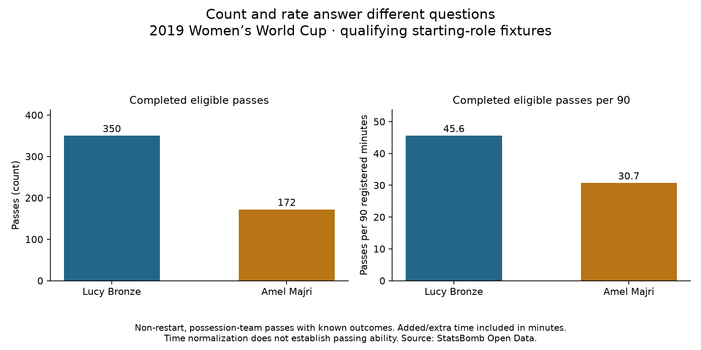

# Fullback passing activity per 90

Competition/season: **2019 FIFA Women’s World Cup** (StatsBomb competition 72, season 30).
Reading: [Soccermatics Lesson 3 — Statistical scouting, Normalisation](https://soccermatics.readthedocs.io/en/latest/lesson3/ScoutingPlayers.html#normalisation).

The unchanged 35-player pool now has matched-scope passing counts and playing-time denominators. Each count uses only the player's qualifying starting-role matches and registered intervals from lesson 64.

## Worked examples

- Lucy Bronze: 350 / 691.184200 × 90 = 45.573958 completed eligible passes per 90.
- Amel Majri: 172 / 504.229850 × 90 = 30.700285 completed eligible passes per 90.

## All player summaries, alphabetical by team and name

- Argentina Women's — Eliana Noemí Stábile: 36/53 eligible passes completed (67.9%); 288.6 minutes; 16.53 attempts and 11.23 completions per 90.
- Australia Women's — Ellie Madison Carpenter: 153/189 eligible passes completed (81.0%); 426.0 minutes; 39.93 attempts and 32.32 completions per 90.
- Brazil Women's — Letícia Santos de Oliveira: 63/87 eligible passes completed (72.4%); 365.9 minutes; 21.40 attempts and 15.50 completions per 90.
- Brazil Women's — Tamires Cássia Dias de Britto: 146/195 eligible passes completed (74.9%); 427.2 minutes; 41.08 attempts and 30.76 completions per 90.
- Cameroon W — Yvonne Patrice Leuko: 37/72 eligible passes completed (51.4%); 302.2 minutes; 21.44 attempts and 11.02 completions per 90.
- Canada Women's — Allysha Lyn Chapman: 74/106 eligible passes completed (69.8%); 250.8 minutes; 38.05 attempts and 26.56 completions per 90.
- Canada Women's — Ashley Elizabeth Marie Lawrence: 106/136 eligible passes completed (77.9%); 291.6 minutes; 41.98 attempts and 32.72 completions per 90.
- China PR Women's — Peng Han: 98/126 eligible passes completed (77.8%); 387.5 minutes; 29.26 attempts and 22.76 completions per 90.
- China PR Women's — Shanshan Liu: 91/116 eligible passes completed (78.4%); 387.5 minutes; 26.94 attempts and 21.13 completions per 90.
- England Women's — Alex Greenwood: 173/218 eligible passes completed (79.4%); 401.3 minutes; 48.89 attempts and 38.80 completions per 90.
- England Women's — Demi Stokes: 101/115 eligible passes completed (87.8%); 289.8 minutes; 35.71 attempts and 31.36 completions per 90.
- England Women's — Lucy Bronze: 350/436 eligible passes completed (80.3%); 691.2 minutes; 56.77 attempts and 45.57 completions per 90.
- France Women's — Amel Majri: 172/222 eligible passes completed (77.5%); 504.2 minutes; 39.62 attempts and 30.70 completions per 90.
- France Women's — Marion Torrent: 106/145 eligible passes completed (73.1%); 412.5 minutes; 31.64 attempts and 23.13 completions per 90.
- Germany Women's — Giulia Gwinn: 88/106 eligible passes completed (83.0%); 294.3 minutes; 32.42 attempts and 26.91 completions per 90.
- Germany Women's — Verena Schweers: 40/55 eligible passes completed (72.7%); 191.3 minutes; 25.88 attempts and 18.82 completions per 90.
- Italy Women's — Alia Guagni: 93/122 eligible passes completed (76.2%); 454.4 minutes; 24.16 attempts and 18.42 completions per 90.
- Italy Women's — Elisa Bartoli: 63/75 eligible passes completed (84.0%); 317.6 minutes; 21.26 attempts and 17.86 completions per 90.
- Jamaica Women's — Deneisha Selena Blackwood: 37/58 eligible passes completed (63.8%); 286.2 minutes; 18.24 attempts and 11.63 completions per 90.
- Japan Women's — Aya Sameshima: 163/206 eligible passes completed (79.1%); 383.0 minutes; 48.41 attempts and 38.31 completions per 90.
- Japan Women's — Risa Shimizu: 168/196 eligible passes completed (85.7%); 383.0 minutes; 46.06 attempts and 39.48 completions per 90.
- Korea Republic Women's — Sel-Gi Jang: 108/134 eligible passes completed (80.6%); 287.3 minutes; 41.97 attempts and 33.83 completions per 90.
- Netherlands Women's — Desiree van Lunteren: 269/350 eligible passes completed (76.9%); 724.0 minutes; 43.51 attempts and 33.44 completions per 90.
- Netherlands Women's — Merel van Dongen: 156/193 eligible passes completed (80.8%); 422.5 minutes; 41.11 attempts and 33.23 completions per 90.
- Nigeria Women's — Chidinma Nkeruka Okeke: 44/62 eligible passes completed (71.0%); 298.2 minutes; 18.71 attempts and 13.28 completions per 90.
- Nigeria Women's — Ngozi Ebere: 47/64 eligible passes completed (73.4%); 269.2 minutes; 21.40 attempts and 15.71 completions per 90.
- Norway Women's — Ingrid Moe Wold: 123/157 eligible passes completed (78.3%); 478.1 minutes; 29.56 attempts and 23.16 completions per 90.
- Norway Women's — Kristine Minde: 92/124 eligible passes completed (74.2%); 524.5 minutes; 21.28 attempts and 15.79 completions per 90.
- South Africa Women's — Lebogang Ramalepe: 51/81 eligible passes completed (63.0%); 290.0 minutes; 25.14 attempts and 15.83 completions per 90.
- Spain Women's — Marta Corredera Rueda: 109/155 eligible passes completed (70.3%); 390.7 minutes; 35.71 attempts and 25.11 completions per 90.
- Sweden Women's — Hanna Erica Maria Glas: 179/221 eligible passes completed (81.0%); 632.6 minutes; 31.44 attempts and 25.47 completions per 90.
- Sweden Women's — Magdalena Lilly Eriksson: 152/211 eligible passes completed (72.0%); 615.3 minutes; 30.86 attempts and 22.23 completions per 90.
- Thailand W — Sunisa Srangthaisong: 44/58 eligible passes completed (75.9%); 289.2 minutes; 18.05 attempts and 13.69 completions per 90.
- United States Women's — Crystal Alyssia Dunn Soubrier: 215/271 eligible passes completed (79.3%); 590.6 minutes; 41.30 attempts and 32.76 completions per 90.
- United States Women's — Kelley Maureen O'Hara: 211/239 eligible passes completed (88.3%); 530.5 minutes; 40.55 attempts and 35.80 completions per 90.

## Definitions

Keep period-1–4 passes by the selected player in the selected fixtures, with timestamps and event order inside the registered interval. Exclude restart deliveries: Throw-in, Corner, Free Kick, Kick Off and Goal Kick. Also exclude passes where possession_team differs from the event team. A pass with no outcome annotation is completed; Incomplete, Out and Pass Offside count as attempted failures. Unknown and Injury Clearance are excluded from both the attempt denominator and completed count. Other unexpected outcome labels stop calculation. No location filter is applied.

This is a non-restart delivery filter, not a claim to remove every set-piece possession: later passes in the same possession may remain. Saved event-ID lists preserve eligible attempts and completed subsets; exclusion categories are applied in the written order and reconcile to candidate pass totals. Passes for a selected identity outside its registered interval trigger an error rather than silently disappearing.

Attempts per 90 = attempts / selected minutes × 90. Completions per 90 uses completed passes instead. Completion percentage = completed / attempted × 100; it does not use minutes. A zero-attempt player has an undefined percentage, not 0%.

## Interpretation

Per-90 activity standardizes the time denominator; it does not adjust for team possession, opponents, game state, passing difficulty or subsequent tactical role changes. Higher completion volume does not automatically mean better passing ability. Left/right starting-role splits remain in the cohort evidence but are not adjusted for here. These are selected-fixture activity profiles, not pure fullback-position measures or current transfer recommendations. No model was trained and no ability ranking is presented.

## Reproduce

Run `python 65_fullback_passing_per90.py` in Spyder or locally. [Evidence](../data/65_fullback_passing_per90_evidence.json) · [Lesson](../lessons/0047-fullback-passing-per90.html) · [Definitions and references](../reference/recruitment-analysis.html). Source: StatsBomb Open Data, **2019 Women’s World Cup**, archived hash-checked event files. This is an assisted worked extension.
