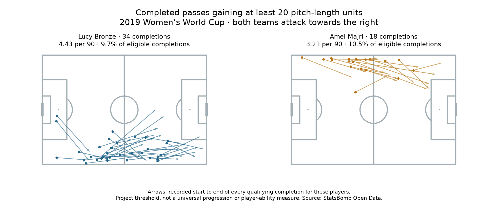

# Fullback passing: substantial forward advancement

Data: **2019 FIFA Women's World Cup**, StatsBomb competition 72 / season 30. Reading: [Soccermatics Lesson 3 — Statistical scouting, Context: what to measure](https://soccermatics.readthedocs.io/en/latest/lesson3/ScoutingPlayers.html#context-what-to-measure).

We enrich the unchanged lesson 65 completed-pass sample with observed start/end coordinates. The project rule counts a completion when **end_x − start_x ≥ 20** on the 0–120 pitch-length scale. Teams act towards x=120 in these normalized coordinates. The threshold is in coordinate units, not metres or total pass length.

## All 35 profiles, alphabetical by team and name

- Argentina Women's — Eliana Noemí Stábile: 4/36 eligible completions meet the rule (11.1%); 1.25 per 90 over 288.6 registered minutes.
- Australia Women's — Ellie Madison Carpenter: 11/153 eligible completions meet the rule (7.2%); 2.32 per 90 over 426.0 registered minutes.
- Brazil Women's — Letícia Santos de Oliveira: 8/63 eligible completions meet the rule (12.7%); 1.97 per 90 over 365.9 registered minutes.
- Brazil Women's — Tamires Cássia Dias de Britto: 22/146 eligible completions meet the rule (15.1%); 4.63 per 90 over 427.2 registered minutes.
- Cameroon W — Yvonne Patrice Leuko: 8/37 eligible completions meet the rule (21.6%); 2.38 per 90 over 302.2 registered minutes.
- Canada Women's — Allysha Lyn Chapman: 5/74 eligible completions meet the rule (6.8%); 1.79 per 90 over 250.8 registered minutes.
- Canada Women's — Ashley Elizabeth Marie Lawrence: 10/106 eligible completions meet the rule (9.4%); 3.09 per 90 over 291.6 registered minutes.
- China PR Women's — Peng Han: 20/98 eligible completions meet the rule (20.4%); 4.65 per 90 over 387.5 registered minutes.
- China PR Women's — Shanshan Liu: 23/91 eligible completions meet the rule (25.3%); 5.34 per 90 over 387.5 registered minutes.
- England Women's — Alex Greenwood: 14/173 eligible completions meet the rule (8.1%); 3.14 per 90 over 401.3 registered minutes.
- England Women's — Demi Stokes: 5/101 eligible completions meet the rule (5.0%); 1.55 per 90 over 289.8 registered minutes.
- England Women's — Lucy Bronze: 34/350 eligible completions meet the rule (9.7%); 4.43 per 90 over 691.2 registered minutes.
- France Women's — Amel Majri: 18/172 eligible completions meet the rule (10.5%); 3.21 per 90 over 504.2 registered minutes.
- France Women's — Marion Torrent: 14/106 eligible completions meet the rule (13.2%); 3.05 per 90 over 412.5 registered minutes.
- Germany Women's — Giulia Gwinn: 4/88 eligible completions meet the rule (4.5%); 1.22 per 90 over 294.3 registered minutes.
- Germany Women's — Verena Schweers: 1/40 eligible completions meet the rule (2.5%); 0.47 per 90 over 191.3 registered minutes.
- Italy Women's — Alia Guagni: 14/93 eligible completions meet the rule (15.1%); 2.77 per 90 over 454.4 registered minutes.
- Italy Women's — Elisa Bartoli: 3/63 eligible completions meet the rule (4.8%); 0.85 per 90 over 317.6 registered minutes.
- Jamaica Women's — Deneisha Selena Blackwood: 6/37 eligible completions meet the rule (16.2%); 1.89 per 90 over 286.2 registered minutes.
- Japan Women's — Aya Sameshima: 24/163 eligible completions meet the rule (14.7%); 5.64 per 90 over 383.0 registered minutes.
- Japan Women's — Risa Shimizu: 13/168 eligible completions meet the rule (7.7%); 3.06 per 90 over 383.0 registered minutes.
- Korea Republic Women's — Sel-Gi Jang: 10/108 eligible completions meet the rule (9.3%); 3.13 per 90 over 287.3 registered minutes.
- Netherlands Women's — Desiree van Lunteren: 34/269 eligible completions meet the rule (12.6%); 4.23 per 90 over 724.0 registered minutes.
- Netherlands Women's — Merel van Dongen: 17/156 eligible completions meet the rule (10.9%); 3.62 per 90 over 422.5 registered minutes.
- Nigeria Women's — Chidinma Nkeruka Okeke: 12/44 eligible completions meet the rule (27.3%); 3.62 per 90 over 298.2 registered minutes.
- Nigeria Women's — Ngozi Ebere: 6/47 eligible completions meet the rule (12.8%); 2.01 per 90 over 269.2 registered minutes.
- Norway Women's — Ingrid Moe Wold: 19/123 eligible completions meet the rule (15.4%); 3.58 per 90 over 478.1 registered minutes.
- Norway Women's — Kristine Minde: 11/92 eligible completions meet the rule (12.0%); 1.89 per 90 over 524.5 registered minutes.
- South Africa Women's — Lebogang Ramalepe: 5/51 eligible completions meet the rule (9.8%); 1.55 per 90 over 290.0 registered minutes.
- Spain Women's — Marta Corredera Rueda: 19/109 eligible completions meet the rule (17.4%); 4.38 per 90 over 390.7 registered minutes.
- Sweden Women's — Hanna Erica Maria Glas: 16/179 eligible completions meet the rule (8.9%); 2.28 per 90 over 632.6 registered minutes.
- Sweden Women's — Magdalena Lilly Eriksson: 26/152 eligible completions meet the rule (17.1%); 3.80 per 90 over 615.3 registered minutes.
- Thailand W — Sunisa Srangthaisong: 7/44 eligible completions meet the rule (15.9%); 2.18 per 90 over 289.2 registered minutes.
- United States Women's — Crystal Alyssia Dunn Soubrier: 29/215 eligible completions meet the rule (13.5%); 4.42 per 90 over 590.6 registered minutes.
- United States Women's — Kelley Maureen O'Hara: 16/211 eligible completions meet the rule (7.6%); 2.71 per 90 over 530.5 registered minutes.

## Concrete recorded examples

- Lucy Bronze: (10.4, 75.1) → (32.5, 76.8); x gain 22.1; pass ID a4f3b3e8-e86d-4753-82e2-ab37fcbaeafe.
- Amel Majri: (53.9, 3.3) → (93.4, 8.8); x gain 39.5; pass ID 1b526257-b7c8-4af3-955a-25bdff16fa99.

These are the first qualifying passes in the saved ledger for two familiar players, selected only to illustrate the rule. They are not representative samples or recommendations. Every qualifying pass for those two players is included in the plotted maps.

## Numerators, denominators and validation

Per 90 = qualifying completion count / the unchanged selected registered minutes × 90. Share = qualifying completions / all eligible completed passes × 100. The share is not pass completion percentage: failed attempts are not its denominator. A zero-completion player has an undefined share.

Every completed eligible pass is retained and checked against its raw event identity, team, player and completion status. Missing or invalid start/end coordinates stop enrichment; none is silently dropped or treated as zero gain. Decimal subtraction makes exact-threshold cases such as 84.6 → 104.6 count correctly. Existing non-restart, possession-team and known-outcome rules and selected fixtures remain unchanged.

## Interpretation

Toy examples: x=40 → 65 gains 25 and qualifies; x=70 → 75 gains five and does not; a sideways pass can be long yet have zero x gain. A pass from x=110 → 119 can be highly valuable near goal while failing this rule. This is a transparent spatial count, not a universal progressive-pass standard, line-breaking measure or action-value model.

We have added direction/context to activity, but not possession adjustment, pressure, defender lines, difficulty or actual role-duration adjustment. Starting zones affect opportunities to gain 20 units: a player already near goal has little room. Higher counts do not establish better ability or current recruitment suitability. This exercise uses already inspected historical data; no new model was trained.

## Reproduce

Run `python 66_fullback_forward_advancement.py` in Spyder or locally. [Protocol](../data/66_forward_advancement_protocol.json) · [Evidence](../data/66_fullback_advancement_evidence.json) · [Lesson](../lessons/0048-fullback-forward-advancement.html). Source: StatsBomb Open Data, **2019 Women's World Cup**, hash-checked archived events. Assisted worked exercise applying course ideas rather than reproducing a standard provider metric.
