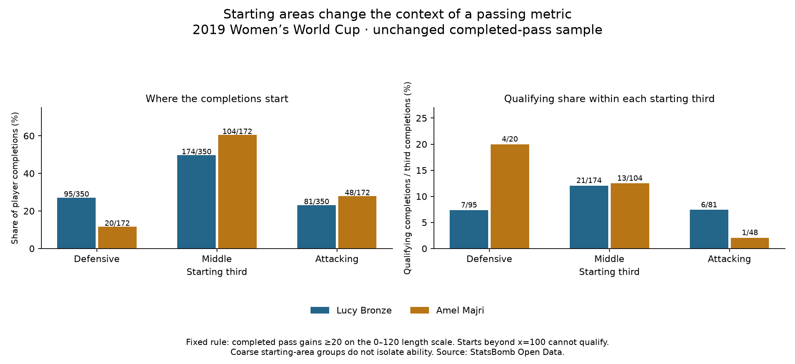

# Starting-area context for forward advancement

Data: **2019 FIFA Women's World Cup**, StatsBomb competition 72 / season 30. Reading: [Soccermatics Lesson 3 — Statistical scouting, Context: what to measure](https://soccermatics.readthedocs.io/en/latest/lesson3/ScoutingPlayers.html#context-what-to-measure).

The fixed measure requires a completed pass to gain at least 20 units along a 0–120 pitch. A pass starting beyond x=100 cannot qualify because even the maximum end_x=120 leaves a gain below 20. A pass at x=100 can still qualify if it ends exactly at x=120. This is a mathematical boundary, not evidence of a feasible passing option or poor play.

We retain every source completion and split by starting third. Within-third share uses the number of completed passes starting in that third as its denominator. It does not use pass attempts or minutes. The original overall shares and per-90 rates remain unchanged.

## A concrete comparison

Bronze has 20/350 completions starting beyond x=100 (5.7%); Majri has 20/172 (11.6%). The same count is a different fraction of their activity. Those passes cannot meet our fixed rule, but they can still be valuable.

In the middle third, Bronze has 21/174 qualifying completions (12.1%) and Majri 13/104 (12.5%). This is a more specific descriptive comparison than mixing all starting areas; it does not make opponents, starting side, exact location, pressure or passing options equal. The small difference does not establish an ability difference or explain the overall difference causally. No significance test was run.

## All 35 profiles

Each fraction below is qualifying completions divided by eligible completions in the stated starting third. Zero exposure means an undefined rate, not 0%.

- Argentina Women's — Eliana Noemí Stábile: Defensive third: 1/17; Middle third: 2/16; Attacking third: 1/3. No coordinate room: 0/36 completions.
- Australia Women's — Ellie Madison Carpenter: Defensive third: 2/26; Middle third: 7/88; Attacking third: 2/39. No coordinate room: 11/153 completions.
- Brazil Women's — Letícia Santos de Oliveira: Defensive third: 5/23; Middle third: 2/30; Attacking third: 1/10. No coordinate room: 0/63 completions.
- Brazil Women's — Tamires Cássia Dias de Britto: Defensive third: 6/58; Middle third: 15/73; Attacking third: 1/15. No coordinate room: 5/146 completions.
- Cameroon W — Yvonne Patrice Leuko: Defensive third: 3/8; Middle third: 5/23; Attacking third: 0/6. No coordinate room: 3/37 completions.
- Canada Women's — Allysha Lyn Chapman: Defensive third: 0/18; Middle third: 5/49; Attacking third: 0/7. No coordinate room: 2/74 completions.
- Canada Women's — Ashley Elizabeth Marie Lawrence: Defensive third: 0/19; Middle third: 10/71; Attacking third: 0/16. No coordinate room: 3/106 completions.
- China PR Women's — Peng Han: Defensive third: 9/35; Middle third: 11/51; Attacking third: 0/12. No coordinate room: 1/98 completions.
- China PR Women's — Shanshan Liu: Defensive third: 4/26; Middle third: 18/50; Attacking third: 1/15. No coordinate room: 5/91 completions.
- England Women's — Alex Greenwood: Defensive third: 4/53; Middle third: 7/91; Attacking third: 3/29. No coordinate room: 5/173 completions.
- England Women's — Demi Stokes: Defensive third: 3/27; Middle third: 2/64; Attacking third: 0/10. No coordinate room: 4/101 completions.
- England Women's — Lucy Bronze: Defensive third: 7/95; Middle third: 21/174; Attacking third: 6/81. No coordinate room: 20/350 completions.
- France Women's — Amel Majri: Defensive third: 4/20; Middle third: 13/104; Attacking third: 1/48. No coordinate room: 20/172 completions.
- France Women's — Marion Torrent: Defensive third: 4/15; Middle third: 10/74; Attacking third: 0/17. No coordinate room: 7/106 completions.
- Germany Women's — Giulia Gwinn: Defensive third: 1/27; Middle third: 3/41; Attacking third: 0/20. No coordinate room: 4/88 completions.
- Germany Women's — Verena Schweers: Defensive third: 0/9; Middle third: 1/25; Attacking third: 0/6. No coordinate room: 1/40 completions.
- Italy Women's — Alia Guagni: Defensive third: 6/37; Middle third: 7/41; Attacking third: 1/15. No coordinate room: 6/93 completions.
- Italy Women's — Elisa Bartoli: Defensive third: 2/23; Middle third: 1/31; Attacking third: 0/9. No coordinate room: 3/63 completions.
- Jamaica Women's — Deneisha Selena Blackwood: Defensive third: 4/12; Middle third: 2/21; Attacking third: 0/4. No coordinate room: 1/37 completions.
- Japan Women's — Aya Sameshima: Defensive third: 6/40; Middle third: 17/100; Attacking third: 1/23. No coordinate room: 5/163 completions.
- Japan Women's — Risa Shimizu: Defensive third: 3/42; Middle third: 8/100; Attacking third: 2/26. No coordinate room: 4/168 completions.
- Korea Republic Women's — Sel-Gi Jang: Defensive third: 2/26; Middle third: 7/60; Attacking third: 1/22. No coordinate room: 4/108 completions.
- Netherlands Women's — Desiree van Lunteren: Defensive third: 9/55; Middle third: 25/164; Attacking third: 0/50. No coordinate room: 7/269 completions.
- Netherlands Women's — Merel van Dongen: Defensive third: 7/39; Middle third: 7/93; Attacking third: 3/24. No coordinate room: 1/156 completions.
- Nigeria Women's — Chidinma Nkeruka Okeke: Defensive third: 7/22; Middle third: 5/20; Attacking third: 0/2. No coordinate room: 0/44 completions.
- Nigeria Women's — Ngozi Ebere: Defensive third: 3/18; Middle third: 2/19; Attacking third: 1/10. No coordinate room: 2/47 completions.
- Norway Women's — Ingrid Moe Wold: Defensive third: 5/28; Middle third: 12/72; Attacking third: 2/23. No coordinate room: 5/123 completions.
- Norway Women's — Kristine Minde: Defensive third: 4/35; Middle third: 5/39; Attacking third: 2/18. No coordinate room: 3/92 completions.
- South Africa Women's — Lebogang Ramalepe: Defensive third: 2/25; Middle third: 3/22; Attacking third: 0/4. No coordinate room: 0/51 completions.
- Spain Women's — Marta Corredera Rueda: Defensive third: 4/17; Middle third: 14/73; Attacking third: 1/19. No coordinate room: 1/109 completions.
- Sweden Women's — Hanna Erica Maria Glas: Defensive third: 4/31; Middle third: 12/94; Attacking third: 0/54. No coordinate room: 8/179 completions.
- Sweden Women's — Magdalena Lilly Eriksson: Defensive third: 8/30; Middle third: 15/83; Attacking third: 3/39. No coordinate room: 6/152 completions.
- Thailand W — Sunisa Srangthaisong: Defensive third: 5/26; Middle third: 1/15; Attacking third: 1/3. No coordinate room: 1/44 completions.
- United States Women's — Crystal Alyssia Dunn Soubrier: Defensive third: 6/52; Middle third: 18/133; Attacking third: 5/30. No coordinate room: 11/215 completions.
- United States Women's — Kelley Maureen O'Hara: Defensive third: 5/58; Middle third: 11/106; Attacking third: 0/47. No coordinate room: 10/211 completions.

## What this audit does not do

The three groups are broad project choices aligned with pitch thirds. We do not refit the metric, remove near-goal completions from the original denominator, produce a standardized ranking, or call every completion with geometric room a genuine football opportunity. Team possession, roles and difficulty remain unadjusted. Matching a coarse third is not matching the full situation. A future choice to change the definition would need to be documented and checked separately.

## Reproduce

Run `python 67_fullback_starting_area_context.py` locally or in Spyder. It uses the saved lesson 66 ledger without downloading data. [Evidence](../data/67_fullback_starting_context_evidence.json) preserves group membership through match/pass keys. [Lesson](../lessons/0049-fullback-starting-area-context.html). Source: StatsBomb Open Data, **2019 Women's World Cup**, via the unchanged hash-linked completed-pass evidence. Assisted worked exercise, not independent proficiency.
