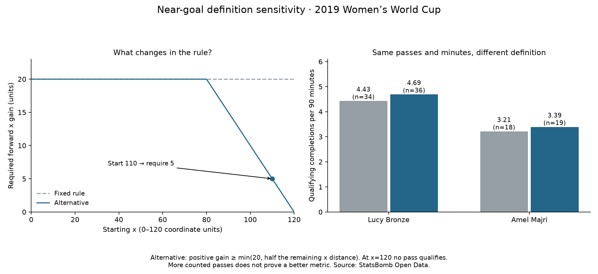

# Test a smaller forward-gain requirement near goal

Data: **2019 FIFA Women's World Cup**, StatsBomb competition 72 / season 30. Reading: [Soccermatics Lesson 3 — Statistical scouting, Context: what to measure](https://soccermatics.readthedocs.io/en/latest/lesson3/ScoutingPlayers.html#context-what-to-measure).

The user identified that the rule should account for near-goal situations. We compare a documented alternative with the original fixed 20-unit rule, keeping all 4158 source completions, players, fixtures and registered minutes unchanged.

## Alternative definition

Required x gain = min(20, 0.5 × (120 − start_x)). A completed eligible pass must advance by a strictly positive amount and meet that requirement. Through x=80, the requirement stays 20. At x=90 it becomes 15; at x=100 it is 10; at x=110 it is five. At x=120, no positive in-pitch gain is possible, so no pass qualifies. Decimal comparisons include the exact threshold.

This is a relative reduction in remaining pitch length along x, not Euclidean distance to goal, total pass length or expected threat. The fraction one half is a chosen exercise setting, not an optimized or universal standard.

## Comparison results

Across the whole selected sample: fixed rule 488; alternative 534; added 46. All fixed-rule positives remain positive under the alternative. Additional passes start beyond x=80 and have positive x gain. More counted passes is an expected consequence of the definition, not validation of quality.

- Argentina Women's — Eliana Noemí Stábile: fixed 4 (1.25/90); alternative 4 (1.25/90); newly included 0.
- Australia Women's — Ellie Madison Carpenter: fixed 11 (2.32/90); alternative 15 (3.17/90); newly included 4.
- Brazil Women's — Letícia Santos de Oliveira: fixed 8 (1.97/90); alternative 8 (1.97/90); newly included 0.
- Brazil Women's — Tamires Cássia Dias de Britto: fixed 22 (4.63/90); alternative 22 (4.63/90); newly included 0.
- Cameroon W — Yvonne Patrice Leuko: fixed 8 (2.38/90); alternative 8 (2.38/90); newly included 0.
- Canada Women's — Allysha Lyn Chapman: fixed 5 (1.79/90); alternative 6 (2.15/90); newly included 1.
- Canada Women's — Ashley Elizabeth Marie Lawrence: fixed 10 (3.09/90); alternative 12 (3.70/90); newly included 2.
- China PR Women's — Peng Han: fixed 20 (4.65/90); alternative 21 (4.88/90); newly included 1.
- China PR Women's — Shanshan Liu: fixed 23 (5.34/90); alternative 25 (5.81/90); newly included 2.
- England Women's — Alex Greenwood: fixed 14 (3.14/90); alternative 16 (3.59/90); newly included 2.
- England Women's — Demi Stokes: fixed 5 (1.55/90); alternative 7 (2.17/90); newly included 2.
- England Women's — Lucy Bronze: fixed 34 (4.43/90); alternative 36 (4.69/90); newly included 2.
- France Women's — Amel Majri: fixed 18 (3.21/90); alternative 19 (3.39/90); newly included 1.
- France Women's — Marion Torrent: fixed 14 (3.05/90); alternative 14 (3.05/90); newly included 0.
- Germany Women's — Giulia Gwinn: fixed 4 (1.22/90); alternative 5 (1.53/90); newly included 1.
- Germany Women's — Verena Schweers: fixed 1 (0.47/90); alternative 1 (0.47/90); newly included 0.
- Italy Women's — Alia Guagni: fixed 14 (2.77/90); alternative 17 (3.37/90); newly included 3.
- Italy Women's — Elisa Bartoli: fixed 3 (0.85/90); alternative 4 (1.13/90); newly included 1.
- Jamaica Women's — Deneisha Selena Blackwood: fixed 6 (1.89/90); alternative 6 (1.89/90); newly included 0.
- Japan Women's — Aya Sameshima: fixed 24 (5.64/90); alternative 26 (6.11/90); newly included 2.
- Japan Women's — Risa Shimizu: fixed 13 (3.06/90); alternative 13 (3.06/90); newly included 0.
- Korea Republic Women's — Sel-Gi Jang: fixed 10 (3.13/90); alternative 10 (3.13/90); newly included 0.
- Netherlands Women's — Desiree van Lunteren: fixed 34 (4.23/90); alternative 37 (4.60/90); newly included 3.
- Netherlands Women's — Merel van Dongen: fixed 17 (3.62/90); alternative 20 (4.26/90); newly included 3.
- Nigeria Women's — Chidinma Nkeruka Okeke: fixed 12 (3.62/90); alternative 12 (3.62/90); newly included 0.
- Nigeria Women's — Ngozi Ebere: fixed 6 (2.01/90); alternative 8 (2.67/90); newly included 2.
- Norway Women's — Ingrid Moe Wold: fixed 19 (3.58/90); alternative 19 (3.58/90); newly included 0.
- Norway Women's — Kristine Minde: fixed 11 (1.89/90); alternative 12 (2.06/90); newly included 1.
- South Africa Women's — Lebogang Ramalepe: fixed 5 (1.55/90); alternative 5 (1.55/90); newly included 0.
- Spain Women's — Marta Corredera Rueda: fixed 19 (4.38/90); alternative 21 (4.84/90); newly included 2.
- Sweden Women's — Hanna Erica Maria Glas: fixed 16 (2.28/90); alternative 18 (2.56/90); newly included 2.
- Sweden Women's — Magdalena Lilly Eriksson: fixed 26 (3.80/90); alternative 29 (4.24/90); newly included 3.
- Thailand W — Sunisa Srangthaisong: fixed 7 (2.18/90); alternative 7 (2.18/90); newly included 0.
- United States Women's — Crystal Alyssia Dunn Soubrier: fixed 29 (4.42/90); alternative 31 (4.72/90); newly included 2.
- United States Women's — Kelley Maureen O'Hara: fixed 16 (2.71/90); alternative 20 (3.39/90); newly included 4.

## Recorded examples newly included

- Player ID 10178, pass 0c5e5756-2841-4f30-9635-7d7656e51871 in match 22936: x=95.6 → 109.7, gain 14.1; alternative requires 12.2.
- Player ID 15249, pass ad95822f-e335-4ae0-8316-50b4ab28fabb in match 22980: x=106.9 → 114.8, gain 7.9; alternative requires 6.55.

The examples are the first newly included ledger pass for each familiar player, not representative samples. Every pass's two classifications and required gain are saved. Earlier lesson results and files remain unchanged.

## What we learned

The original metric had a geometric blind spot beyond x=100; this alternative allows some advancing passes there to count. It still misses valuable sideways/backward passes, ignores pressure and defender lines, and may reward tiny x gains extremely close to goal. A pass can be a good decision without meeting either rule. Neither definition has been validated as an action-value measure or shown to identify better players. We did not search fractions, train a model or evaluate against independent pass-value labels. This is definition sensitivity on already inspected data.

## Reproduce

Run `python 68_adaptive_forward_advancement.py` in Spyder or locally. [Protocol](../data/68_adaptive_advancement_protocol.json) · [Evidence](../data/68_adaptive_advancement_evidence.json) · [Lesson](../lessons/0050-adaptive-forward-advancement.html). Source: StatsBomb Open Data, **2019 Women's World Cup**, via saved hash-linked pass evidence. Assisted worked extension of the user's idea.
