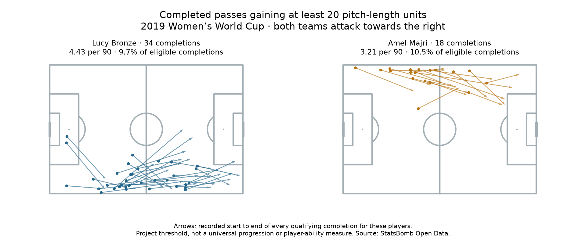

# Two historical fullback profiles: what should a scout review next?

**Alireza Erfanian · Football Analytics Research Lab · 6 November 2026 · Guided portfolio work**

**Data:** FIFA Women's World Cup, **2019** (StatsBomb competition 72 / season 30). **Reading:** [Soccermatics Lesson 3 — Statistical scouting, Modesty](https://soccermatics.readthedocs.io/en/latest/lesson3/ScoutingPlayers.html#modesty).

**Question:** What passing patterns are visible for these two fullback examples, and what observations would help interpret them? The full profiling pool contains 35 players. Bronze and Majri were selected as familiar communication examples, not as the top two candidates. Their starting sides differ, so do not treat them as interchangeable recruitment options.

## Lucy Bronze · England Women's

7 right back starts; 691.2 reconstructed registered minutes in those qualifying fixtures.

- Passing activity: 350/436 eligible attempts completed (80.3%); **45.57 completions per 90**.
- Fixed forward rule: 34 completions; **4.43/90**, 9.7% of eligible completions. Near-goal alternative: 36; **4.69/90**.
- Context: 20 starts beyond x=100 (5.7% of completions). Within the middle third, 21/174 meet the fixed rule (12.1%).

## Amel Majri · France Women's

5 left back starts; 504.2 reconstructed registered minutes in those qualifying fixtures.

- Passing activity: 172/222 eligible attempts completed (77.5%); **30.70 completions per 90**.
- Fixed forward rule: 18 completions; **3.21/90**, 10.5% of eligible completions. Near-goal alternative: 19; **3.39/90**.
- Context: 20 starts beyond x=100 (11.6% of completions). Within the middle third, 13/104 meet the fixed rule (12.5%).

## What the figures support

Bronze recorded more eligible completions per 90 in her selected matches. Majri had a slightly higher fraction meeting the fixed forward rule, while the two middle-third fractions were close. These describe observed activity and starting-area context; they do not isolate passing ability. The alternative definition adds two Bronze passes and one Majri pass, without validating either rule as an action-value measure.

## Next action: review these four examples

- Lucy Bronze vs Scotland W, 2019-06-09, period 1 at 23:43: Fixed-rule example; [10.4, 75.1] → [32.5, 76.8], gain 22.1. Recipient: Nikita Parris. Match 22936, event a4f3b3e8-e86d-4753-82e2-ab37fcbaeafe. **Not reviewed.**
- Lucy Bronze vs Scotland W, 2019-06-09, period 2 at 85:02: Additional alternative-rule example; [95.6, 68.8] → [109.7, 63.1], gain 14.1. Recipient: Georgia Stanway. Match 22936, event 0c5e5756-2841-4f30-9635-7d7656e51871. **Not reviewed.**
- Amel Majri vs Korea Republic Women's, 2019-06-07, period 1 at 02:30: Fixed-rule example; [53.9, 3.3] → [93.4, 8.8], gain 39.5. Recipient: Kadidiatou Diani. Match 22921, event 1b526257-b7c8-4af3-955a-25bdff16fa99. **Not reviewed.**
- Amel Majri vs Nigeria Women's, 2019-06-17, period 2 at 94:48: Additional alternative-rule example; [106.9, 2.3] → [114.8, 6.0], gain 7.9. Recipient: Eugénie Le Sommer. Match 22980, event ad95822f-e335-4ae0-8316-50b4ab28fabb. **Not reviewed.**

The four examples deliberately illustrate the two definitions; they are not representative samples of player performance. Event clocks are recorded match/period references, not video-file timestamps. No footage has been accessed or watched for this brief; observations are unfilled. The full statistical results above use all eligible events, not just these examples.

For each review, ask: which passing options were available, how much pressure did the passer face, did the recipient control the ball, and what happened next? Record observable answers before judging a decision. Then check whether patterns recur across additional matches and comparable role contexts.

## Limits and definitions

Eligible passes are non-restart, possession-team passes with known outcomes in each player's qualifying starting-role fixtures and registered intervals. Registered minutes include recorded added/extra time and retain temporary absences; halftime and shootouts are excluded. These are not independently checked official minute totals or verified fullback-position minutes. The initial pool required three qualifying starts, an exercise filter rather than a reliability guarantee.

Fixed rule: completed end_x − start_x ≥20 on the 0–120 length scale. Alternative: strictly positive gain ≥min(20, half the remaining x distance). Both ignore defender lines, pressure, lateral value and realistic options. Per-90 rates do not adjust for possession, opponent or later role changes. No ability ranking or signing recommendation follows from this brief. Current form, availability, contract and price are outside this historical dataset.

## Inspect and reproduce

Run `python 69_fullback_recruitment_brief.py` in Spyder or locally. [Styled brief](52_fullback_recruitment_brief.html) · [Evidence and source hashes](../data/69_fullback_recruitment_brief_evidence.json) · [Lesson 69](../lessons/0051-fullback-recruitment-brief.html) · [Full 35-player activity report](48_fullback_passing_per90.md).

Data: [StatsBomb Open Data](https://github.com/statsbomb/open-data), **2019 Women's World Cup**. Guided analysis and report prepared with AI assistance. Independent reproduction, explanation and video observation remain separate milestones.
