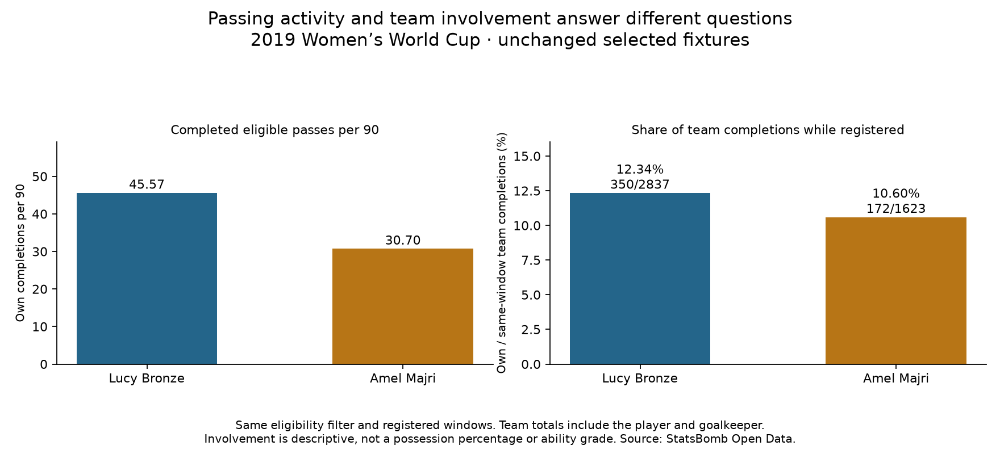

# Fullback involvement in team passing

Data: **2019 FIFA Women's World Cup**, StatsBomb competition 72 / season 30. Reading: [Soccermatics Lesson 3 — Statistical scouting, Normalisation](https://soccermatics.readthedocs.io/en/latest/lesson3/ScoutingPlayers.html#normalisation).

Question: what fraction of her team's eligible completed passes did a player make while she was registered on the pitch in the selected fixtures?

- Lucy Bronze: 350 / 2837 ×100 = 12.34%.
- Amel Majri: 172 / 1623 ×100 = 10.60%.

## All 35 profiles

- Argentina Women's — Eliana Noemí Stábile: 36/461 same-window team completions = 7.81%; own completions 11.23/90, team completions 143.77 per selected-player 90.
- Australia Women's — Ellie Madison Carpenter: 153/1677 same-window team completions = 9.12%; own completions 32.32/90, team completions 354.27 per selected-player 90.
- Brazil Women's — Letícia Santos de Oliveira: 63/1024 same-window team completions = 6.15%; own completions 15.50/90, team completions 251.88 per selected-player 90.
- Brazil Women's — Tamires Cássia Dias de Britto: 146/1143 same-window team completions = 12.77%; own completions 30.76/90, team completions 240.80 per selected-player 90.
- Cameroon W — Yvonne Patrice Leuko: 37/488 same-window team completions = 7.58%; own completions 11.02/90, team completions 145.34 per selected-player 90.
- Canada Women's — Allysha Lyn Chapman: 74/992 same-window team completions = 7.46%; own completions 26.56/90, team completions 356.05 per selected-player 90.
- Canada Women's — Ashley Elizabeth Marie Lawrence: 106/1105 same-window team completions = 9.59%; own completions 32.72/90, team completions 341.06 per selected-player 90.
- China PR Women's — Peng Han: 98/1010 same-window team completions = 9.70%; own completions 22.76/90, team completions 234.57 per selected-player 90.
- China PR Women's — Shanshan Liu: 91/1010 same-window team completions = 9.01%; own completions 21.13/90, team completions 234.57 per selected-player 90.
- England Women's — Alex Greenwood: 173/1741 same-window team completions = 9.94%; own completions 38.80/90, team completions 390.42 per selected-player 90.
- England Women's — Demi Stokes: 101/1096 same-window team completions = 9.22%; own completions 31.36/90, team completions 340.32 per selected-player 90.
- England Women's — Lucy Bronze: 350/2837 same-window team completions = 12.34%; own completions 45.57/90, team completions 369.41 per selected-player 90.
- France Women's — Amel Majri: 172/1623 same-window team completions = 10.60%; own completions 30.70/90, team completions 289.69 per selected-player 90.
- France Women's — Marion Torrent: 106/1263 same-window team completions = 8.39%; own completions 23.13/90, team completions 275.57 per selected-player 90.
- Germany Women's — Giulia Gwinn: 88/1135 same-window team completions = 7.75%; own completions 26.91/90, team completions 347.11 per selected-player 90.
- Germany Women's — Verena Schweers: 40/526 same-window team completions = 7.60%; own completions 18.82/90, team completions 247.46 per selected-player 90.
- Italy Women's — Alia Guagni: 93/901 same-window team completions = 10.32%; own completions 18.42/90, team completions 178.46 per selected-player 90.
- Italy Women's — Elisa Bartoli: 63/781 same-window team completions = 8.07%; own completions 17.86/90, team completions 221.35 per selected-player 90.
- Jamaica Women's — Deneisha Selena Blackwood: 37/484 same-window team completions = 7.64%; own completions 11.63/90, team completions 152.19 per selected-player 90.
- Japan Women's — Aya Sameshima: 163/1687 same-window team completions = 9.66%; own completions 38.31/90, team completions 396.46 per selected-player 90.
- Japan Women's — Risa Shimizu: 168/1687 same-window team completions = 9.96%; own completions 39.48/90, team completions 396.46 per selected-player 90.
- Korea Republic Women's — Sel-Gi Jang: 108/944 same-window team completions = 11.44%; own completions 33.83/90, team completions 295.69 per selected-player 90.
- Netherlands Women's — Desiree van Lunteren: 269/2611 same-window team completions = 10.30%; own completions 33.44/90, team completions 324.58 per selected-player 90.
- Netherlands Women's — Merel van Dongen: 156/1469 same-window team completions = 10.62%; own completions 33.23/90, team completions 312.91 per selected-player 90.
- Nigeria Women's — Chidinma Nkeruka Okeke: 44/360 same-window team completions = 12.22%; own completions 13.28/90, team completions 108.66 per selected-player 90.
- Nigeria Women's — Ngozi Ebere: 47/428 same-window team completions = 10.98%; own completions 15.71/90, team completions 143.08 per selected-player 90.
- Norway Women's — Ingrid Moe Wold: 123/1340 same-window team completions = 9.18%; own completions 23.16/90, team completions 252.27 per selected-player 90.
- Norway Women's — Kristine Minde: 92/1487 same-window team completions = 6.19%; own completions 15.79/90, team completions 255.17 per selected-player 90.
- South Africa Women's — Lebogang Ramalepe: 51/549 same-window team completions = 9.29%; own completions 15.83/90, team completions 170.39 per selected-player 90.
- Spain Women's — Marta Corredera Rueda: 109/1471 same-window team completions = 7.41%; own completions 25.11/90, team completions 338.89 per selected-player 90.
- Sweden Women's — Hanna Erica Maria Glas: 179/1787 same-window team completions = 10.02%; own completions 25.47/90, team completions 254.24 per selected-player 90.
- Sweden Women's — Magdalena Lilly Eriksson: 152/1762 same-window team completions = 8.63%; own completions 22.23/90, team completions 257.74 per selected-player 90.
- Thailand W — Sunisa Srangthaisong: 44/369 same-window team completions = 11.92%; own completions 13.69/90, team completions 114.83 per selected-player 90.
- United States Women's — Crystal Alyssia Dunn Soubrier: 215/1912 same-window team completions = 11.24%; own completions 32.76/90, team completions 291.36 per selected-player 90.
- United States Women's — Kelley Maureen O'Hara: 211/1805 same-window team completions = 11.69%; own completions 35.80/90, team completions 306.22 per selected-player 90.

## Matching the denominator

The original qualifying fullback-start fixtures and registered intervals remain unchanged. We apply lesson 65's eligibility filter to all registered teammates, including the goalkeeper and the player herself. Only team completions within the target player's clock interval and event-order bounds enter her denominator. A teammate's pass after the target player was substituted off is excluded from that target's window. Player completions are checked as a subset of the corresponding team completions. Each window retains both ID lists for audit.

Counts are pooled across the player's selected windows before division; we do not average match percentages. The share is not pass completion percentage: the denominator is completed team passes, not the player's attempts. A zero-team-completion window does not create a 0% rate; if pooled exposure is zero, the share is undefined.

The identity is own completions per 90 = team completions per selected-player 90 × own share as a fraction. It decomposes observed activity; it does not prove how much opportunity or ability caused the result. A team event may appear in both fullbacks' denominators because each has a separate, valid involvement question. Summing these denominators does not give a unique tournament pass total.

## Interpretation

Per 90 standardizes playing time. This extra measure places that activity within recorded team passing volume. It is not a provider possession percentage, an estimate of minutes in possession, or a fully adjusted player ability score. Role, side, game state, passing difficulty, teammates and team style remain relevant. We have not demonstrated that higher involvement is tactically better. Registered time still includes added/extra time and temporary absences, excludes halftime and shootouts, and is not verified fullback-position time.

## Reproduce

Run `python 70_fullback_team_passing_share.py` in Spyder or locally. [Evidence](../data/70_fullback_team_passing_share_evidence.json) · [Lesson](../lessons/0052-fullback-team-passing-share.html). Source: StatsBomb Open Data, **2019 Women's World Cup**, via the existing hash-checked match snapshots. Assisted historical exercise; no ability ranking or new model.
