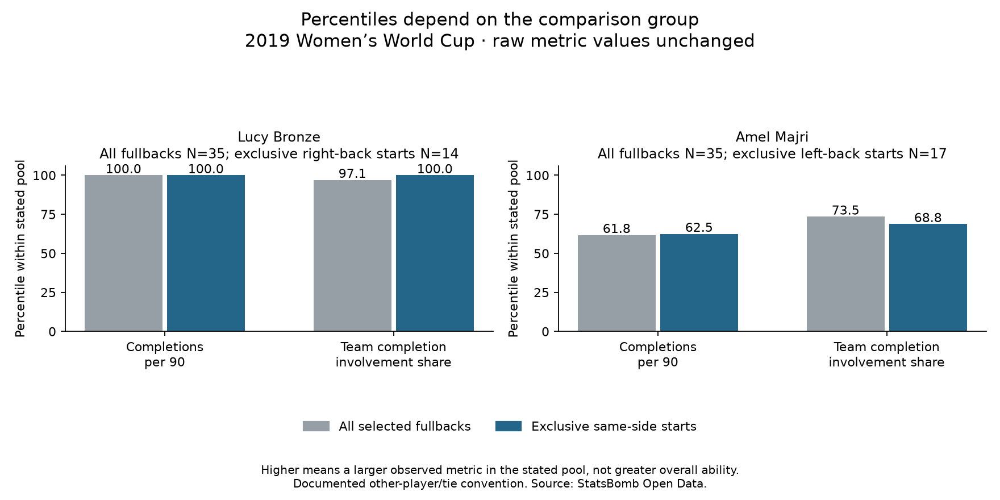

# Fullback percentiles: always name the comparison pool

Data: **2019 FIFA Women's World Cup**, StatsBomb competition 72 / season 30. Reading: [Soccermatics Lesson 3 — Statistical scouting, Comparison: percentile rankings](https://soccermatics.readthedocs.io/en/latest/lesson3/ScoutingPlayers.html#comparison-percentile-rankings).

We place two unchanged raw measures—completed eligible passes per registered 90 and share of same-window team completions—within explicit peer groups. A higher percentile means a larger value for that measure in the named group, not a better footballer.

## Comparison groups

- All selected fullbacks: 35 player/team identities.
- Exclusively left-back qualifying starts: 17.
- Exclusively right-back qualifying starts: 14.

Four mixed-side players remain in the all-fullback comparison and have no exclusive-side percentile. These are recorded starting-role filters, not verified role-duration measures. The same three-start selection from lesson 63 remains in force; the smaller groups do not guarantee reliable ability estimates.

## How the percentile is calculated

Compare a target to other valid players in the pool: 100 × (number strictly lower + half the number tied) / number of other valid players. Unrounded metric values determine ties. For unique extremes, the lowest is 0 and highest 100; if every other value is tied, the result is 50. Missing values are not zero, and a lone valid player has an undefined percentile. This is our documented convention; software percentile-rank definitions differ.

For Majri's passing activity, 21 of the other 34 fullbacks have lower values, with no ties: 21/34 ×100 = 61.8. Her value remains 30.70 completions per 90. Bronze has the highest activity in this selected group, so all 34 others are lower and her activity percentile is 100. Neither number is pass-completion percentage or a general ability grade.

Majri's involvement percentile changes from 73.5 among all 35 to 68.8 among the 17 exclusive left-back starters. Her involvement value stays 10.60%. The reference group changed; her actions did not. Matching starting side is only one context filter, not a full adjustment for role, possession, opponents or difficulty.

## All profiles, alphabetical by team and name

- Argentina Women's — Eliana Noemí Stábile (left_only): all-fullback activity percentile 2.9 (N=35), involvement 23.5 (N=35); exclusive-side comparison: activity 6.2 (N=17), involvement 31.2 (N=17).
- Australia Women's — Ellie Madison Carpenter (right_only): all-fullback activity percentile 70.6 (N=35), involvement 38.2 (N=35); exclusive-side comparison: activity 61.5 (N=14), involvement 23.1 (N=14).
- Brazil Women's — Letícia Santos de Oliveira (right_only): all-fullback activity percentile 14.7 (N=35), involvement 0.0 (N=35); exclusive-side comparison: activity 7.7 (N=14), involvement 0.0 (N=14).
- Brazil Women's — Tamires Cássia Dias de Britto (left_only): all-fullback activity percentile 64.7 (N=35), involvement 100.0 (N=35); exclusive-side comparison: activity 68.8 (N=17), involvement 100.0 (N=17).
- Cameroon W — Yvonne Patrice Leuko (left_only): all-fullback activity percentile 0.0 (N=35), involvement 11.8 (N=35); exclusive-side comparison: activity 0.0 (N=17), involvement 12.5 (N=17).
- Canada Women's — Allysha Lyn Chapman (left_only): all-fullback activity percentile 55.9 (N=35), involvement 8.8 (N=35); exclusive-side comparison: activity 56.2 (N=17), involvement 6.2 (N=17).
- Canada Women's — Ashley Elizabeth Marie Lawrence (right_only): all-fullback activity percentile 73.5 (N=35), involvement 50.0 (N=35); exclusive-side comparison: activity 69.2 (N=14), involvement 46.2 (N=14).
- China PR Women's — Peng Han (right_only): all-fullback activity percentile 41.2 (N=35), involvement 55.9 (N=35); exclusive-side comparison: activity 23.1 (N=14), involvement 53.8 (N=14).
- China PR Women's — Shanshan Liu (left_only): all-fullback activity percentile 35.3 (N=35), involvement 35.3 (N=35); exclusive-side comparison: activity 43.8 (N=17), involvement 43.8 (N=17).
- England Women's — Alex Greenwood (left_only): all-fullback activity percentile 94.1 (N=35), involvement 58.8 (N=35); exclusive-side comparison: activity 100.0 (N=17), involvement 62.5 (N=17).
- England Women's — Demi Stokes (left_only): all-fullback activity percentile 67.6 (N=35), involvement 44.1 (N=35); exclusive-side comparison: activity 75.0 (N=17), involvement 50.0 (N=17).
- England Women's — Lucy Bronze (right_only): all-fullback activity percentile 100.0 (N=35), involvement 97.1 (N=35); exclusive-side comparison: activity 100.0 (N=14), involvement 100.0 (N=14).
- France Women's — Amel Majri (left_only): all-fullback activity percentile 61.8 (N=35), involvement 73.5 (N=35); exclusive-side comparison: activity 62.5 (N=17), involvement 68.8 (N=17).
- France Women's — Marion Torrent (right_only): all-fullback activity percentile 44.1 (N=35), involvement 29.4 (N=35); exclusive-side comparison: activity 30.8 (N=14), involvement 15.4 (N=14).
- Germany Women's — Giulia Gwinn (right_only): all-fullback activity percentile 58.8 (N=35), involvement 20.6 (N=35); exclusive-side comparison: activity 53.8 (N=14), involvement 7.7 (N=14).
- Germany Women's — Verena Schweers (left_only): all-fullback activity percentile 32.4 (N=35), involvement 14.7 (N=35); exclusive-side comparison: activity 37.5 (N=17), involvement 18.8 (N=17).
- Italy Women's — Alia Guagni (mixed): all-fullback activity percentile 29.4 (N=35), involvement 70.6 (N=35); exclusive-side comparison: not computed for mixed-side starts.
- Italy Women's — Elisa Bartoli (mixed): all-fullback activity percentile 26.5 (N=35), involvement 26.5 (N=35); exclusive-side comparison: not computed for mixed-side starts.
- Jamaica Women's — Deneisha Selena Blackwood (left_only): all-fullback activity percentile 5.9 (N=35), involvement 17.6 (N=35); exclusive-side comparison: activity 12.5 (N=17), involvement 25.0 (N=17).
- Japan Women's — Aya Sameshima (left_only): all-fullback activity percentile 91.2 (N=35), involvement 52.9 (N=35); exclusive-side comparison: activity 93.8 (N=17), involvement 56.2 (N=17).
- Japan Women's — Risa Shimizu (right_only): all-fullback activity percentile 97.1 (N=35), involvement 61.8 (N=35); exclusive-side comparison: activity 92.3 (N=14), involvement 61.5 (N=14).
- Korea Republic Women's — Sel-Gi Jang (mixed): all-fullback activity percentile 85.3 (N=35), involvement 85.3 (N=35); exclusive-side comparison: not computed for mixed-side starts.
- Netherlands Women's — Desiree van Lunteren (right_only): all-fullback activity percentile 82.4 (N=35), involvement 67.6 (N=35); exclusive-side comparison: activity 76.9 (N=14), involvement 76.9 (N=14).
- Netherlands Women's — Merel van Dongen (left_only): all-fullback activity percentile 79.4 (N=35), involvement 76.5 (N=35); exclusive-side comparison: activity 87.5 (N=17), involvement 75.0 (N=17).
- Nigeria Women's — Chidinma Nkeruka Okeke (right_only): all-fullback activity percentile 8.8 (N=35), involvement 94.1 (N=35); exclusive-side comparison: activity 0.0 (N=14), involvement 92.3 (N=14).
- Nigeria Women's — Ngozi Ebere (left_only): all-fullback activity percentile 17.6 (N=35), involvement 79.4 (N=35); exclusive-side comparison: activity 25.0 (N=17), involvement 81.2 (N=17).
- Norway Women's — Ingrid Moe Wold (right_only): all-fullback activity percentile 47.1 (N=35), involvement 41.2 (N=35); exclusive-side comparison: activity 38.5 (N=14), involvement 30.8 (N=14).
- Norway Women's — Kristine Minde (left_only): all-fullback activity percentile 20.6 (N=35), involvement 2.9 (N=35); exclusive-side comparison: activity 31.2 (N=17), involvement 0.0 (N=17).
- South Africa Women's — Lebogang Ramalepe (right_only): all-fullback activity percentile 23.5 (N=35), involvement 47.1 (N=35); exclusive-side comparison: activity 15.4 (N=14), involvement 38.5 (N=14).
- Spain Women's — Marta Corredera Rueda (mixed): all-fullback activity percentile 50.0 (N=35), involvement 5.9 (N=35); exclusive-side comparison: not computed for mixed-side starts.
- Sweden Women's — Hanna Erica Maria Glas (right_only): all-fullback activity percentile 52.9 (N=35), involvement 64.7 (N=35); exclusive-side comparison: activity 46.2 (N=14), involvement 69.2 (N=14).
- Sweden Women's — Magdalena Lilly Eriksson (left_only): all-fullback activity percentile 38.2 (N=35), involvement 32.4 (N=35); exclusive-side comparison: activity 50.0 (N=17), involvement 37.5 (N=17).
- Thailand W — Sunisa Srangthaisong (left_only): all-fullback activity percentile 11.8 (N=35), involvement 91.2 (N=35); exclusive-side comparison: activity 18.8 (N=17), involvement 93.8 (N=17).
- United States Women's — Crystal Alyssia Dunn Soubrier (left_only): all-fullback activity percentile 76.5 (N=35), involvement 82.4 (N=35); exclusive-side comparison: activity 81.2 (N=17), involvement 87.5 (N=17).
- United States Women's — Kelley Maureen O'Hara (right_only): all-fullback activity percentile 88.2 (N=35), involvement 88.2 (N=35); exclusive-side comparison: activity 84.6 (N=14), involvement 84.6 (N=14).

## Use and limits

Percentiles summarize relative position, not the size or football importance of a difference. A small raw gap can change rank. These small historical cohorts do not establish present-day ability, significance, uncertainty intervals or recruitment suitability. No metric values were changed or combined into an overall player score. More passing activity or involvement is not automatically tactically preferable.

Run `python 71_fullback_percentile_comparisons.py` in Spyder or locally. [Evidence](../data/71_fullback_percentile_evidence.json) preserves pool membership, valid peer counts and lower/tied/higher counts. [Lesson](../lessons/0053-fullback-percentile-comparisons.html). Source: StatsBomb Open Data, **2019 Women's World Cup**, through saved audited profiles. Assisted worked exercise; no model fitting or video observation.
