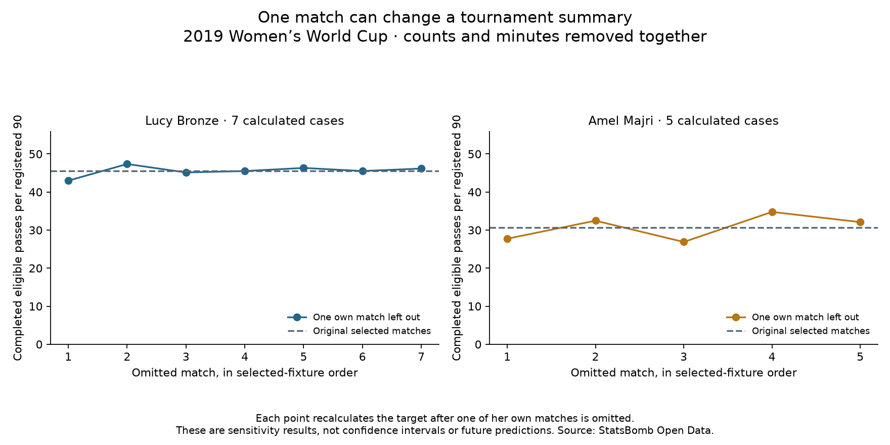

# How much does a single match influence a fullback profile?

Data: **2019 FIFA Women's World Cup**, StatsBomb competition 72 / season 30. Course reading: [Soccermatics Lesson 3 — Statistical scouting, Comparison: percentile rankings](https://soccermatics.readthedocs.io/en/latest/lesson3/ScoutingPlayers.html#comparison-percentile-rankings). This is a custom sensitivity extension, not the course's exact assignment.

We recalculate each player's two passing measures after omitting each of her own qualifying match windows in turn. All 35 original players stay in the reference population; the 145 target-specific cases remove own completions, same-window team completions and registered minutes together.

## Worked interpretation

Bronze's original activity is 45.57 completions per 90. The seven calculated values after omitting each own match range from 42.99 to 47.36. Majri's original value is 30.70; her five deletion values range from 26.88 to 34.77. These describe dependence on the observed selected matches. They do not show how either player will perform in a future match or prove one is more reliable.

## All profiles

- Argentina Women's — Eliana Noemí Stábile: baseline activity 11.23/90; one-own-match-omitted activity 7.95–14.51/90; involvement 7.39–8.14%; fixed-peer activity percentile 0.00–11.76. 3 cases.
- Australia Women's — Ellie Madison Carpenter: baseline activity 32.32/90; one-own-match-omitted activity 28.67–34.61/90; involvement 8.54–9.32%; fixed-peer activity percentile 61.76–85.29. 4 cases.
- Brazil Women's — Letícia Santos de Oliveira: baseline activity 15.50/90; one-own-match-omitted activity 11.97–17.14/90; involvement 5.10–6.93%; fixed-peer activity percentile 8.82–23.53. 4 cases.
- Brazil Women's — Tamires Cássia Dias de Britto: baseline activity 30.76/90; one-own-match-omitted activity 28.65–35.20/90; involvement 12.06–13.38%; fixed-peer activity percentile 61.76–85.29. 4 cases.
- Cameroon W — Yvonne Patrice Leuko: baseline activity 11.02/90; one-own-match-omitted activity 9.58–13.90/90; involvement 7.01–8.40%; fixed-peer activity percentile 0.00–11.76. 3 cases.
- Canada Women's — Allysha Lyn Chapman: baseline activity 26.56/90; one-own-match-omitted activity 22.44–30.67/90; involvement 7.12–7.80%; fixed-peer activity percentile 41.18–58.82. 3 cases.
- Canada Women's — Ashley Elizabeth Marie Lawrence: baseline activity 32.72/90; one-own-match-omitted activity 26.46–36.66/90; involvement 8.77–10.60%; fixed-peer activity percentile 55.88–88.24. 3 cases.
- China PR Women's — Peng Han: baseline activity 22.76/90; one-own-match-omitted activity 17.76–26.79/90; involvement 9.07–10.34%; fixed-peer activity percentile 26.47–55.88. 4 cases.
- China PR Women's — Shanshan Liu: baseline activity 21.13/90; one-own-match-omitted activity 18.39–24.82/90; involvement 8.32–9.59%; fixed-peer activity percentile 29.41–47.06. 4 cases.
- England Women's — Alex Greenwood: baseline activity 38.80/90; one-own-match-omitted activity 36.33–42.94/90; involvement 9.46–10.76%; fixed-peer activity percentile 91.18–97.06. 4 cases.
- England Women's — Demi Stokes: baseline activity 31.36/90; one-own-match-omitted activity 26.10–36.61/90; involvement 7.63–10.16%; fixed-peer activity percentile 55.88–88.24. 3 cases.
- England Women's — Lucy Bronze: baseline activity 45.57/90; one-own-match-omitted activity 42.99–47.36/90; involvement 11.85–13.15%; fixed-peer activity percentile 100.00–100.00. 7 cases.
- France Women's — Amel Majri: baseline activity 30.70/90; one-own-match-omitted activity 26.88–34.77/90; involvement 9.99–11.14%; fixed-peer activity percentile 58.82–85.29. 5 cases.
- France Women's — Marion Torrent: baseline activity 23.13/90; one-own-match-omitted activity 17.33–26.23/90; involvement 8.04–8.60%; fixed-peer activity percentile 26.47–52.94. 4 cases.
- Germany Women's — Giulia Gwinn: baseline activity 26.91/90; one-own-match-omitted activity 24.43–29.13/90; involvement 7.62–7.88%; fixed-peer activity percentile 50.00–58.82. 3 cases.
- Germany Women's — Verena Schweers: baseline activity 18.82/90; one-own-match-omitted activity 10.55–30.08/90; involvement 5.69–8.65%; fixed-peer activity percentile 0.00–58.82. 3 cases.
- Italy Women's — Alia Guagni: baseline activity 18.42/90; one-own-match-omitted activity 16.70–21.83/90; involvement 9.00–11.53%; fixed-peer activity percentile 26.47–35.29. 5 cases.
- Italy Women's — Elisa Bartoli: baseline activity 17.86/90; one-own-match-omitted activity 13.91–22.21/90; involvement 7.64–8.81%; fixed-peer activity percentile 14.71–35.29. 4 cases.
- Jamaica Women's — Deneisha Selena Blackwood: baseline activity 11.63/90; one-own-match-omitted activity 9.90–13.06/90; involvement 6.19–9.47%; fixed-peer activity percentile 0.00–5.88. 3 cases.
- Japan Women's — Aya Sameshima: baseline activity 38.31/90; one-own-match-omitted activity 35.44–42.41/90; involvement 9.10–10.17%; fixed-peer activity percentile 88.24–97.06. 4 cases.
- Japan Women's — Risa Shimizu: baseline activity 39.48/90; one-own-match-omitted activity 32.93–44.30/90; involvement 9.31–10.63%; fixed-peer activity percentile 79.41–97.06. 4 cases.
- Korea Republic Women's — Sel-Gi Jang: baseline activity 33.83/90; one-own-match-omitted activity 30.98–37.10/90; involvement 10.77–13.10%; fixed-peer activity percentile 67.65–88.24. 3 cases.
- Netherlands Women's — Desiree van Lunteren: baseline activity 33.44/90; one-own-match-omitted activity 30.56–36.18/90; involvement 9.69–10.94%; fixed-peer activity percentile 61.76–88.24. 7 cases.
- Netherlands Women's — Merel van Dongen: baseline activity 33.23/90; one-own-match-omitted activity 29.62–38.49/90; involvement 10.12–11.46%; fixed-peer activity percentile 61.76–91.18. 4 cases.
- Nigeria Women's — Chidinma Nkeruka Okeke: baseline activity 13.28/90; one-own-match-omitted activity 10.24–15.42/90; involvement 11.31–13.29%; fixed-peer activity percentile 0.00–11.76. 3 cases.
- Nigeria Women's — Ngozi Ebere: baseline activity 15.71/90; one-own-match-omitted activity 12.99–18.03/90; involvement 10.37–11.45%; fixed-peer activity percentile 8.82–26.47. 3 cases.
- Norway Women's — Ingrid Moe Wold: baseline activity 23.16/90; one-own-match-omitted activity 20.16–27.30/90; involvement 8.38–10.27%; fixed-peer activity percentile 35.29–58.82. 5 cases.
- Norway Women's — Kristine Minde: baseline activity 15.79/90; one-own-match-omitted activity 13.04–17.00/90; involvement 5.37–6.46%; fixed-peer activity percentile 8.82–23.53. 5 cases.
- South Africa Women's — Lebogang Ramalepe: baseline activity 15.83/90; one-own-match-omitted activity 10.17–22.08/90; involvement 7.33–10.12%; fixed-peer activity percentile 0.00–35.29. 3 cases.
- Spain Women's — Marta Corredera Rueda: baseline activity 25.11/90; one-own-match-omitted activity 21.93–27.69/90; involvement 6.77–7.98%; fixed-peer activity percentile 38.24–58.82. 4 cases.
- Sweden Women's — Hanna Erica Maria Glas: baseline activity 25.47/90; one-own-match-omitted activity 20.65–28.18/90; involvement 9.69–10.40%; fixed-peer activity percentile 35.29–58.82. 6 cases.
- Sweden Women's — Magdalena Lilly Eriksson: baseline activity 22.23/90; one-own-match-omitted activity 18.92–24.89/90; involvement 8.29–8.91%; fixed-peer activity percentile 35.29–47.06. 6 cases.
- Thailand W — Sunisa Srangthaisong: baseline activity 13.69/90; one-own-match-omitted activity 12.62–15.32/90; involvement 11.25–12.31%; fixed-peer activity percentile 8.82–11.76. 3 cases.
- United States Women's — Crystal Alyssia Dunn Soubrier: baseline activity 32.76/90; one-own-match-omitted activity 27.63–35.97/90; involvement 10.93–11.68%; fixed-peer activity percentile 61.76–88.24. 6 cases.
- United States Women's — Kelley Maureen O'Hara: baseline activity 35.80/90; one-own-match-omitted activity 31.03–40.34/90; involvement 11.19–12.10%; fixed-peer activity percentile 67.65–97.06. 6 cases.

## What is held fixed

Only the target's own observed windows change in each case. Other players—including teammates or opponents from that fixture—keep their original full-sample values. Their original cohort eligibility also stays fixed. A player selected for three fullback starts remains in this conditional exercise after one is removed; we do not re-run a two-start recruitment selection. We use the overall fullback pool for percentile comparisons, not the exclusive-side pools.

The percentile change therefore answers a narrow question: where would this altered target profile sit against the original other players? It is not a global removal of the match from the tournament, a fresh-data test or a causal adjustment. Counts are pooled and divided by the remaining registered exposure; match percentages are not averaged.

## Limits

The minimum and maximum are simply the smallest and largest calculated deletion values. They are not 95% confidence intervals or complete uncertainty estimates, and narrow ranges do not prove stable ability. Minutes still use the registered-time convention with recorded added/extra time, temporary absences retained and halftime/shootouts excluded. Role, team possession, difficulty and opponents remain incompletely adjusted for. No signing recommendation or model fitting follows from this exercise.

## Reproduce

Run `python 72_fullback_match_sensitivity.py` in Spyder or locally. It uses saved windows and profiles without downloading data. [Evidence](../data/72_fullback_match_sensitivity_evidence.json) records every omitted match ID, remaining counts/minutes and fixed-peer ranks. [Lesson](../lessons/0054-fullback-match-sensitivity.html). Source: StatsBomb Open Data, **2019 Women's World Cup**, through the unchanged hash-linked records. Assisted historical exercise.
