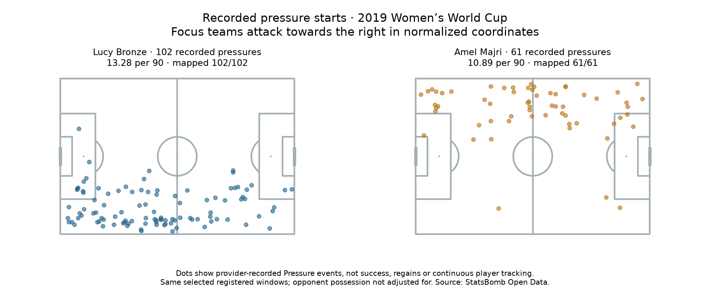

# Defensive participation: recorded pressure activity

Data: **2019 FIFA Women's World Cup**, StatsBomb competition 72 / season 30. Reading: [Soccermatics Lesson 3 — Counts of actions](https://soccermatics.readthedocs.io/en/latest/lesson3/ScoutingPlayers.html#counts-of-actions) and [Normalisation](https://soccermatics.readthedocs.io/en/latest/lesson3/ScoutingPlayers.html#normalisation).

We add a defensive activity count to the existing 35-player fullback profiling exercise. We count the provider's recorded Pressure events, representing a player applying pressure to an attacking player. We do not detect pressure ourselves from player proximity or infer it from pass outcomes. The counted event is the start of the recorded pressure; duration is not summed or weighted.

## Worked examples

- Lucy Bronze: 102 / 691.184200 ×90 = 13.281554 pressures per 90.
- Amel Majri: 61 / 504.229850 ×90 = 10.887892 pressures per 90.

## All profiles, alphabetical by team and name

- Argentina Women's — Eliana Noemí Stábile: 52 recorded pressures in 288.6 registered minutes; **16.22/90**; valid map locations 52/52.
- Australia Women's — Ellie Madison Carpenter: 55 recorded pressures in 426.0 registered minutes; **11.62/90**; valid map locations 55/55.
- Brazil Women's — Letícia Santos de Oliveira: 59 recorded pressures in 365.9 registered minutes; **14.51/90**; valid map locations 59/59.
- Brazil Women's — Tamires Cássia Dias de Britto: 54 recorded pressures in 427.2 registered minutes; **11.38/90**; valid map locations 54/54.
- Cameroon W — Yvonne Patrice Leuko: 60 recorded pressures in 302.2 registered minutes; **17.87/90**; valid map locations 60/60.
- Canada Women's — Allysha Lyn Chapman: 37 recorded pressures in 250.8 registered minutes; **13.28/90**; valid map locations 37/37.
- Canada Women's — Ashley Elizabeth Marie Lawrence: 57 recorded pressures in 291.6 registered minutes; **17.59/90**; valid map locations 57/57.
- China PR Women's — Peng Han: 56 recorded pressures in 387.5 registered minutes; **13.01/90**; valid map locations 56/56.
- China PR Women's — Shanshan Liu: 48 recorded pressures in 387.5 registered minutes; **11.15/90**; valid map locations 48/48.
- England Women's — Alex Greenwood: 52 recorded pressures in 401.3 registered minutes; **11.66/90**; valid map locations 52/52.
- England Women's — Demi Stokes: 53 recorded pressures in 289.8 registered minutes; **16.46/90**; valid map locations 53/53.
- England Women's — Lucy Bronze: 102 recorded pressures in 691.2 registered minutes; **13.28/90**; valid map locations 102/102.
- France Women's — Amel Majri: 61 recorded pressures in 504.2 registered minutes; **10.89/90**; valid map locations 61/61.
- France Women's — Marion Torrent: 58 recorded pressures in 412.5 registered minutes; **12.65/90**; valid map locations 58/58.
- Germany Women's — Giulia Gwinn: 36 recorded pressures in 294.3 registered minutes; **11.01/90**; valid map locations 36/36.
- Germany Women's — Verena Schweers: 37 recorded pressures in 191.3 registered minutes; **17.41/90**; valid map locations 37/37.
- Italy Women's — Alia Guagni: 57 recorded pressures in 454.4 registered minutes; **11.29/90**; valid map locations 57/57.
- Italy Women's — Elisa Bartoli: 70 recorded pressures in 317.6 registered minutes; **19.84/90**; valid map locations 70/70.
- Jamaica Women's — Deneisha Selena Blackwood: 49 recorded pressures in 286.2 registered minutes; **15.41/90**; valid map locations 49/49.
- Japan Women's — Aya Sameshima: 45 recorded pressures in 383.0 registered minutes; **10.58/90**; valid map locations 45/45.
- Japan Women's — Risa Shimizu: 36 recorded pressures in 383.0 registered minutes; **8.46/90**; valid map locations 36/36.
- Korea Republic Women's — Sel-Gi Jang: 45 recorded pressures in 287.3 registered minutes; **14.10/90**; valid map locations 45/45.
- Netherlands Women's — Desiree van Lunteren: 86 recorded pressures in 724.0 registered minutes; **10.69/90**; valid map locations 86/86.
- Netherlands Women's — Merel van Dongen: 73 recorded pressures in 422.5 registered minutes; **15.55/90**; valid map locations 73/73.
- Nigeria Women's — Chidinma Nkeruka Okeke: 23 recorded pressures in 298.2 registered minutes; **6.94/90**; valid map locations 23/23.
- Nigeria Women's — Ngozi Ebere: 37 recorded pressures in 269.2 registered minutes; **12.37/90**; valid map locations 37/37.
- Norway Women's — Ingrid Moe Wold: 49 recorded pressures in 478.1 registered minutes; **9.22/90**; valid map locations 49/49.
- Norway Women's — Kristine Minde: 72 recorded pressures in 524.5 registered minutes; **12.36/90**; valid map locations 72/72.
- South Africa Women's — Lebogang Ramalepe: 73 recorded pressures in 290.0 registered minutes; **22.66/90**; valid map locations 73/73.
- Spain Women's — Marta Corredera Rueda: 82 recorded pressures in 390.7 registered minutes; **18.89/90**; valid map locations 82/82.
- Sweden Women's — Hanna Erica Maria Glas: 109 recorded pressures in 632.6 registered minutes; **15.51/90**; valid map locations 109/109.
- Sweden Women's — Magdalena Lilly Eriksson: 46 recorded pressures in 615.3 registered minutes; **6.73/90**; valid map locations 46/46.
- Thailand W — Sunisa Srangthaisong: 48 recorded pressures in 289.2 registered minutes; **14.94/90**; valid map locations 48/48.
- United States Women's — Crystal Alyssia Dunn Soubrier: 93 recorded pressures in 590.6 registered minutes; **14.17/90**; valid map locations 93/93.
- United States Women's — Kelley Maureen O'Hara: 64 recorded pressures in 530.5 registered minutes; **10.86/90**; valid map locations 64/64.

## Matched scope and location coverage

Each numerator uses the player's unchanged qualifying fullback-start fixtures and registered intervals from lesson 64. Both elapsed time and event order are checked. Added/extra time and temporary absences retain the earlier registered-time convention; halftime and shootouts are excluded. Later role changes are included, so these are not verified position-specific minutes or actions.

Pressure events are off-ball actions. We do not copy the passing filter requiring event team to equal possession team: that would omit legitimate defensive actions against an opponent in possession. A pass event labelled under_pressure is also not counted as a Pressure event by the passer. Restart-delivery filters for passes are not applied to this distinct event type.

Counts include every selected Pressure event regardless of location availability. Missing or invalid in-pitch coordinate pairs are saved as unmapped, never moved to (0,0) or dropped from the count. Map dots show recorded start locations, not running trajectories or all defensive positioning. Window event IDs and source hashes allow replay.

## Football interpretation

More pressures per 90 means more recorded pressure activity in these selected minutes. It does not establish that the actions were successful, led to regains, or made the player a better defender. A player with less pressure activity may have faced fewer opportunities or followed different instructions. We have not adjusted for opponent possession, game state, difficulty or team tactics. No pressure-regain metric or causal effect is calculated here. This is a custom defensive extension applying the course's counts/context ideas, not a complete defensive assessment or signing recommendation.

## Reproduce

Run `python 73_fullback_pressure_activity.py` in Spyder or locally. [Evidence](../data/73_fullback_pressure_activity_evidence.json) · [Lesson](../lessons/0055-fullback-pressure-activity.html). Source: StatsBomb Open Data, **2019 Women's World Cup**, hash-checked archived events. Definition: [Open Data specification, Pressure event](https://raw.githubusercontent.com/statsbomb/open-data/master/doc/StatsBomb%20Open%20Data%20Specification%20v1.1.pdf). Assisted worked exercise; no new model or video observation.
