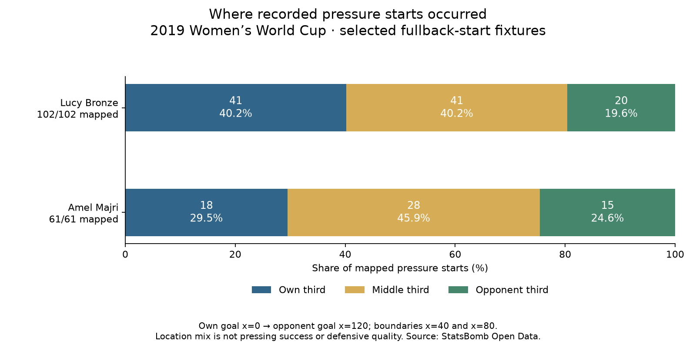

# Where did the fullbacks apply pressure?

Data: **2019 FIFA Women's World Cup**, StatsBomb competition 72 / season 30.
Reading: [Soccermatics Lesson 3 — Context: what to measure](https://soccermatics.readthedocs.io/en/latest/lesson3/ScoutingPlayers.html#context-what-to-measure). Custom assisted assignment, applying the course's context principle.

## Definition

Split the 120-unit pitch length into three equal sections, from the event team's perspective: own goal at x=0, opponent goal at x=120. Own third: 0≤x<40; middle: 40≤x<80; opponent third: 80≤x≤120. Width y is not used to split the thirds, but valid two-dimensional locations are required. These are coordinate units, not metres. No second-half flip is applied to the already normalized event coordinates.

The original 35-player cohort, qualifying fixtures, registered minutes and all 2,034 recorded Pressure starts remain unchanged. We classify saved starts, not full pressure paths. Each mapped event enters exactly one third, with event keys retained. Unknown locations remain counted in the overall pressure total and are never placed in a guessed third.

## All profiles (alphabetical)

- **Argentina Women's — Eliana Noemí Stábile**: Own third: 39 (75.00% of mapped; 12.16/90); Middle third: 12 (23.08% of mapped; 3.74/90); Opponent third: 1 (1.92% of mapped; 0.31/90). Coverage: 52/52 mapped.
- **Australia Women's — Ellie Madison Carpenter**: Own third: 19 (34.55% of mapped; 4.01/90); Middle third: 31 (56.36% of mapped; 6.55/90); Opponent third: 5 (9.09% of mapped; 1.06/90). Coverage: 55/55 mapped.
- **Brazil Women's — Letícia Santos de Oliveira**: Own third: 37 (62.71% of mapped; 9.10/90); Middle third: 17 (28.81% of mapped; 4.18/90); Opponent third: 5 (8.47% of mapped; 1.23/90). Coverage: 59/59 mapped.
- **Brazil Women's — Tamires Cássia Dias de Britto**: Own third: 26 (48.15% of mapped; 5.48/90); Middle third: 19 (35.19% of mapped; 4.00/90); Opponent third: 9 (16.67% of mapped; 1.90/90). Coverage: 54/54 mapped.
- **Cameroon W — Yvonne Patrice Leuko**: Own third: 37 (61.67% of mapped; 11.02/90); Middle third: 21 (35.00% of mapped; 6.25/90); Opponent third: 2 (3.33% of mapped; 0.60/90). Coverage: 60/60 mapped.
- **Canada Women's — Allysha Lyn Chapman**: Own third: 20 (54.05% of mapped; 7.18/90); Middle third: 16 (43.24% of mapped; 5.74/90); Opponent third: 1 (2.70% of mapped; 0.36/90). Coverage: 37/37 mapped.
- **Canada Women's — Ashley Elizabeth Marie Lawrence**: Own third: 18 (31.58% of mapped; 5.56/90); Middle third: 30 (52.63% of mapped; 9.26/90); Opponent third: 9 (15.79% of mapped; 2.78/90). Coverage: 57/57 mapped.
- **China PR Women's — Peng Han**: Own third: 35 (62.50% of mapped; 8.13/90); Middle third: 19 (33.93% of mapped; 4.41/90); Opponent third: 2 (3.57% of mapped; 0.46/90). Coverage: 56/56 mapped.
- **China PR Women's — Shanshan Liu**: Own third: 33 (68.75% of mapped; 7.66/90); Middle third: 11 (22.92% of mapped; 2.55/90); Opponent third: 4 (8.33% of mapped; 0.93/90). Coverage: 48/48 mapped.
- **England Women's — Alex Greenwood**: Own third: 26 (50.00% of mapped; 5.83/90); Middle third: 20 (38.46% of mapped; 4.49/90); Opponent third: 6 (11.54% of mapped; 1.35/90). Coverage: 52/52 mapped.
- **England Women's — Demi Stokes**: Own third: 32 (60.38% of mapped; 9.94/90); Middle third: 16 (30.19% of mapped; 4.97/90); Opponent third: 5 (9.43% of mapped; 1.55/90). Coverage: 53/53 mapped.
- **England Women's — Lucy Bronze**: Own third: 41 (40.20% of mapped; 5.34/90); Middle third: 41 (40.20% of mapped; 5.34/90); Opponent third: 20 (19.61% of mapped; 2.60/90). Coverage: 102/102 mapped.
- **France Women's — Amel Majri**: Own third: 18 (29.51% of mapped; 3.21/90); Middle third: 28 (45.90% of mapped; 5.00/90); Opponent third: 15 (24.59% of mapped; 2.68/90). Coverage: 61/61 mapped.
- **France Women's — Marion Torrent**: Own third: 25 (43.10% of mapped; 5.45/90); Middle third: 20 (34.48% of mapped; 4.36/90); Opponent third: 13 (22.41% of mapped; 2.84/90). Coverage: 58/58 mapped.
- **Germany Women's — Giulia Gwinn**: Own third: 15 (41.67% of mapped; 4.59/90); Middle third: 12 (33.33% of mapped; 3.67/90); Opponent third: 9 (25.00% of mapped; 2.75/90). Coverage: 36/36 mapped.
- **Germany Women's — Verena Schweers**: Own third: 21 (56.76% of mapped; 9.88/90); Middle third: 13 (35.14% of mapped; 6.12/90); Opponent third: 3 (8.11% of mapped; 1.41/90). Coverage: 37/37 mapped.
- **Italy Women's — Alia Guagni**: Own third: 41 (71.93% of mapped; 8.12/90); Middle third: 13 (22.81% of mapped; 2.57/90); Opponent third: 3 (5.26% of mapped; 0.59/90). Coverage: 57/57 mapped.
- **Italy Women's — Elisa Bartoli**: Own third: 39 (55.71% of mapped; 11.05/90); Middle third: 22 (31.43% of mapped; 6.24/90); Opponent third: 9 (12.86% of mapped; 2.55/90). Coverage: 70/70 mapped.
- **Jamaica Women's — Deneisha Selena Blackwood**: Own third: 29 (59.18% of mapped; 9.12/90); Middle third: 17 (34.69% of mapped; 5.35/90); Opponent third: 3 (6.12% of mapped; 0.94/90). Coverage: 49/49 mapped.
- **Japan Women's — Aya Sameshima**: Own third: 21 (46.67% of mapped; 4.94/90); Middle third: 16 (35.56% of mapped; 3.76/90); Opponent third: 8 (17.78% of mapped; 1.88/90). Coverage: 45/45 mapped.
- **Japan Women's — Risa Shimizu**: Own third: 18 (50.00% of mapped; 4.23/90); Middle third: 14 (38.89% of mapped; 3.29/90); Opponent third: 4 (11.11% of mapped; 0.94/90). Coverage: 36/36 mapped.
- **Korea Republic Women's — Sel-Gi Jang**: Own third: 27 (60.00% of mapped; 8.46/90); Middle third: 14 (31.11% of mapped; 4.39/90); Opponent third: 4 (8.89% of mapped; 1.25/90). Coverage: 45/45 mapped.
- **Netherlands Women's — Desiree van Lunteren**: Own third: 42 (48.84% of mapped; 5.22/90); Middle third: 32 (37.21% of mapped; 3.98/90); Opponent third: 12 (13.95% of mapped; 1.49/90). Coverage: 86/86 mapped.
- **Netherlands Women's — Merel van Dongen**: Own third: 42 (57.53% of mapped; 8.95/90); Middle third: 25 (34.25% of mapped; 5.33/90); Opponent third: 6 (8.22% of mapped; 1.28/90). Coverage: 73/73 mapped.
- **Nigeria Women's — Chidinma Nkeruka Okeke**: Own third: 20 (86.96% of mapped; 6.04/90); Middle third: 3 (13.04% of mapped; 0.91/90); Opponent third: 0 (0.00% of mapped; 0.00/90). Coverage: 23/23 mapped.
- **Nigeria Women's — Ngozi Ebere**: Own third: 28 (75.68% of mapped; 9.36/90); Middle third: 7 (18.92% of mapped; 2.34/90); Opponent third: 2 (5.41% of mapped; 0.67/90). Coverage: 37/37 mapped.
- **Norway Women's — Ingrid Moe Wold**: Own third: 29 (59.18% of mapped; 5.46/90); Middle third: 14 (28.57% of mapped; 2.64/90); Opponent third: 6 (12.24% of mapped; 1.13/90). Coverage: 49/49 mapped.
- **Norway Women's — Kristine Minde**: Own third: 47 (65.28% of mapped; 8.07/90); Middle third: 18 (25.00% of mapped; 3.09/90); Opponent third: 7 (9.72% of mapped; 1.20/90). Coverage: 72/72 mapped.
- **South Africa Women's — Lebogang Ramalepe**: Own third: 48 (65.75% of mapped; 14.90/90); Middle third: 22 (30.14% of mapped; 6.83/90); Opponent third: 3 (4.11% of mapped; 0.93/90). Coverage: 73/73 mapped.
- **Spain Women's — Marta Corredera Rueda**: Own third: 45 (54.88% of mapped; 10.37/90); Middle third: 26 (31.71% of mapped; 5.99/90); Opponent third: 11 (13.41% of mapped; 2.53/90). Coverage: 82/82 mapped.
- **Sweden Women's — Hanna Erica Maria Glas**: Own third: 49 (44.95% of mapped; 6.97/90); Middle third: 42 (38.53% of mapped; 5.98/90); Opponent third: 18 (16.51% of mapped; 2.56/90). Coverage: 109/109 mapped.
- **Sweden Women's — Magdalena Lilly Eriksson**: Own third: 25 (54.35% of mapped; 3.66/90); Middle third: 10 (21.74% of mapped; 1.46/90); Opponent third: 11 (23.91% of mapped; 1.61/90). Coverage: 46/46 mapped.
- **Thailand W — Sunisa Srangthaisong**: Own third: 46 (95.83% of mapped; 14.31/90); Middle third: 1 (2.08% of mapped; 0.31/90); Opponent third: 1 (2.08% of mapped; 0.31/90). Coverage: 48/48 mapped.
- **United States Women's — Crystal Alyssia Dunn Soubrier**: Own third: 51 (54.84% of mapped; 7.77/90); Middle third: 31 (33.33% of mapped; 4.72/90); Opponent third: 11 (11.83% of mapped; 1.68/90). Coverage: 93/93 mapped.
- **United States Women's — Kelley Maureen O'Hara**: Own third: 31 (48.44% of mapped; 5.26/90); Middle third: 19 (29.69% of mapped; 3.22/90); Opponent third: 14 (21.88% of mapped; 2.38/90). Coverage: 64/64 mapped.

## Two questions, two denominators

Share in an area = area's pressures / all mapped pressures ×100. This describes the location mix of observed actions. Area pressures per90 = area's count / original registered minutes ×90. This describes location-specific activity per playing time, not per minute spent in that area. Do not average match percentages. With no mapped pressures the location shares are undefined; an empty area with other mapped pressures is a measured zero. Area counts plus unmapped counts reconcile to the original total.

More opponent-third pressures does not prove better defending, a coordinated high press, tactical instructions or pressing success. These coarse bins provide context for future review. No opponent passing-volume adjustment is applied to the area metrics, and no individual zone-exposure time is available. The two familiar examples are illustrations, not a ranking of interchangeable signing options.

## Reproduce

Run `python 75_fullback_pressure_areas.py` in Spyder. [Evidence](../data/75_fullback_pressure_areas_evidence.json) · [Lesson](../lessons/0057-fullback-pressure-areas.html).
Source: StatsBomb Open Data; [event specification and coordinate convention](https://raw.githubusercontent.com/statsbomb/open-data/master/doc/StatsBomb%20Open%20Data%20Specification%20v1.1.pdf).
No footage observation, model fitting or independent mastery claim.
