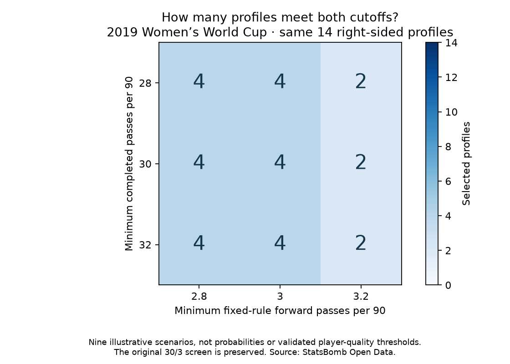

# Does a small cutoff change alter the scouting screen?

Data: **2019 FIFA Women's World Cup**, StatsBomb competition 72 / season 30.
Reading: [Soccermatics Lesson 3 — Case study: spreadsheet scouting](https://soccermatics.readthedocs.io/en/latest/lesson3/SpreadsheetScout.html). This is a custom sensitivity extension of our SQL tool.

We keep the original 14 right-sided profiles, minimum 3 starts, all player data and metric definitions fixed. Only completed-pass floors 28/30/32 per 90 and fixed-rule forward floors 2.8/3.0/3.2 per 90 vary, giving nine scenarios. The original 30/3 case is included and checked against lesson82. These are illustrative neighbourhood choices; changing to another grid can change scenario inclusion counts.

## Results by scenario

At the original completed-pass floor 30, raising the forward floor from 3 to 3.2 changes the list from 4 to 2; removed profiles: Ashley Elizabeth Marie Lawrence, Risa Shimizu. Changing the completed-pass floor within the tested range does not change membership at any fixed tested forward floor.

- Completed≥28, forward≥2.8: **4 profiles**; added: None; removed: None.
- Completed≥28, forward≥3: **4 profiles**; added: None; removed: None.
- Completed≥28, forward≥3.2: **2 profiles**; added: None; removed: Ashley Elizabeth Marie Lawrence, Risa Shimizu.
- Completed≥30, forward≥2.8: **4 profiles**; added: None; removed: None.
- Completed≥30, forward≥3: **4 profiles**; added: None; removed: None.
- Completed≥30, forward≥3.2: **2 profiles**; added: None; removed: Ashley Elizabeth Marie Lawrence, Risa Shimizu.
- Completed≥32, forward≥2.8: **4 profiles**; added: None; removed: None.
- Completed≥32, forward≥3: **4 profiles**; added: None; removed: None.
- Completed≥32, forward≥3.2: **2 profiles**; added: None; removed: Ashley Elizabeth Marie Lawrence, Risa Shimizu.

## Membership across the chosen scenarios

- **Desiree van Lunteren**: 33.44 completed/90, 4.23 fixed-rule forward/90; selected in **9/9 tested scenarios**; original selection yes.
- **Lucy Bronze**: 45.57 completed/90, 4.43 fixed-rule forward/90; selected in **9/9 tested scenarios**; original selection yes.
- **Ashley Elizabeth Marie Lawrence**: 32.72 completed/90, 3.09 fixed-rule forward/90; selected in **6/9 tested scenarios**; original selection yes.
- **Risa Shimizu**: 39.48 completed/90, 3.06 fixed-rule forward/90; selected in **6/9 tested scenarios**; original selection yes.
- **Chidinma Nkeruka Okeke**: 13.28 completed/90, 3.62 fixed-rule forward/90; selected in **0/9 tested scenarios**; original selection no.
- **Ellie Madison Carpenter**: 32.32 completed/90, 2.32 fixed-rule forward/90; selected in **0/9 tested scenarios**; original selection no.
- **Giulia Gwinn**: 26.91 completed/90, 1.22 fixed-rule forward/90; selected in **0/9 tested scenarios**; original selection no.
- **Hanna Erica Maria Glas**: 25.47 completed/90, 2.28 fixed-rule forward/90; selected in **0/9 tested scenarios**; original selection no.
- **Ingrid Moe Wold**: 23.16 completed/90, 3.58 fixed-rule forward/90; selected in **0/9 tested scenarios**; original selection no.
- **Kelley Maureen O'Hara**: 35.80 completed/90, 2.71 fixed-rule forward/90; selected in **0/9 tested scenarios**; original selection no.
- **Lebogang Ramalepe**: 15.83 completed/90, 1.55 fixed-rule forward/90; selected in **0/9 tested scenarios**; original selection no.
- **Letícia Santos de Oliveira**: 15.50 completed/90, 1.97 fixed-rule forward/90; selected in **0/9 tested scenarios**; original selection no.
- **Marion Torrent**: 23.13 completed/90, 3.05 fixed-rule forward/90; selected in **0/9 tested scenarios**; original selection no.
- **Peng Han**: 22.76 completed/90, 4.65 fixed-rule forward/90; selected in **0/9 tested scenarios**; original selection no.

## Interpretation

A profile can sit close to a chosen line without a meaningful football difference from one just below it. Assess the actual values and circumstances rather than interpreting binary membership as ability. Inclusion in all tested cases means only that the selected floors did not remove the profile. Six of nine cases is not a two-thirds probability of suitability, and these cases are not independent samples or fresh validation.

The original shortlist and data remain unchanged. The exercise does not test sensitivity to the three-start rule, starting-role classification, minutes reconstruction, forward-pass definition, match composition, missing events, opponent strength or future seasons. It neither picks an optimal cutoff nor confirms signings. All comparisons use unrounded values; the chart reports counts, not uncertainty.

## Reproduce

Run `python 83_scouting_screen_sensitivity.py` in Spyder. [Scenario protocol](../data/83_screen_sensitivity_protocol.json) · [Evidence, memberships and source hashes](../data/83_scouting_screen_sensitivity_evidence.json) · [Lesson](../lessons/0065-scouting-screen-sensitivity.html).
Source: StatsBomb Open Data. Assisted implementation; independent user mastery and footage review remain separate milestones.
